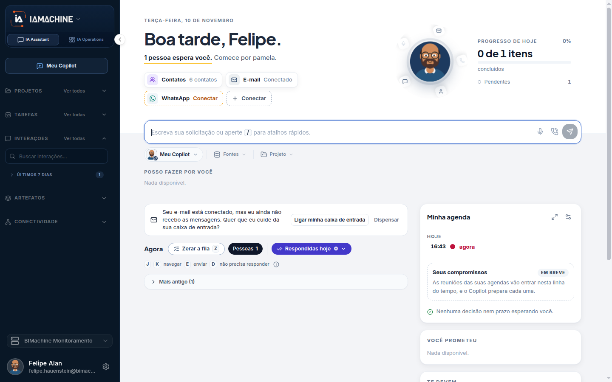

# IA Assistant

O IA Assistant é o lado pessoal da plataforma. A aba da esquerda abre o chat. Dali você conversa, agrupa conversas, pede uma tarefa sua, acha o que já falou e guarda o que o chat produziu. A operação da empresa, com colaboradores, fluxos e a Torre, fica na outra aba.

## Para que serve

O Assistant é o chat com o Meu Copilot e com os colaboradores digitais.

## Quem vê

A pessoa dona do Copilot. Tarefas do Copilot somem sem projeto. Meus conectores só aparecem para administrador.

## Onde fica

A aba da esquerda abre em `/chat`.

## O que a tela mostra

O menu mostra **Meu Copilot**, **PROJETOS**, **TAREFAS**, **INTERAÇÕES**, **ARTEFATOS** e **CONECTIVIDADE**. A caixa diz **Boa tarde, Felipe.**

O menu pessoal do Assistant reúne o chat, os projetos de conversa, as tarefas da pessoa, as interações, os artefatos, os dispositivos e os conectores da pessoa.

Cada entrada responde a uma pergunta diferente:

* **Chat.** Onde a conversa acontece.
* **Projetos.** Pastas das suas conversas. Não é o projeto da empresa.
* **Tarefas do Copilot.** O que o seu Copilot dispara para você. Não é a agenda dos colaboradores digitais.
* **Interações.** A lista viva das conversas, no próprio menu.
* **Artefatos.** O que nasceu ou foi compartilhado no chat.
* **Dispositivos.** O aparelho ligado à conta. A mesma página existe na outra aba.
* **Meus conectores.** O que o seu Copilot pode usar. Só administrador.

## Campos

Esta página não tem formulário.

## O que dá para fazer

Abrir cada tela do menu.

<table data-view="cards"><thead><tr><th>Menu</th><th data-card-target data-type="content-ref">Abrir</th></tr></thead><tbody><tr><td><strong>Meu Copilot no chat</strong> Dá para falar com o Meu Copilot ou com um colaborador digital.</td><td><a href="chat.md">chat</a></td></tr><tr><td><strong>Projetos</strong> No menu, os 5 mais recentes e ver todos.</td><td><a href="projetos.md">projetos</a></td></tr><tr><td><strong>Tarefas do Copilot</strong> Tarefas que o Copilot da pessoa dispara. Some sem projeto.</td><td><a href="tarefas.md">tarefas</a></td></tr><tr><td><strong>Interações</strong> Lista viva no menu: busca, filtro por projeto e agrupamento por período.</td><td><a href="interacoes.md">interacoes</a></td></tr><tr><td><strong>Artefatos do chat</strong> Meus artefatos e Compartilhado comigo.</td><td><a href="artefatos.md">artefatos</a></td></tr><tr><td><strong>Dispositivos</strong> O aparelho mostra um código. A pessoa registra esse código.</td><td><a href="dispositivos.md">dispositivos</a></td></tr><tr><td><strong>Meus conectores</strong> Conectores que o Meu Copilot pode usar. Só administrador.</td><td><a href="meus-conectores.md">meus-conectores</a></td></tr></tbody></table>

## Limite atual

Meus conectores pedem administrador. Tarefas do Copilot somem sem projeto.

## Dúvidas comuns

**Acabei o primeiro acesso. Onde começo?**
No Chat, em Nova interação, com o seu Copilot já escolhido. Voz, e-mail e WhatsApp podem ser conectados depois, em Perfil.

**A tarefa que eu agendei não aparece na lista Tarefas da outra aba.**
É outra lista. A sua fica em Tarefas do Copilot. A de Operations pertence a um colaborador digital do projeto.

**Não vejo Meus conectores.**
A entrada só aparece para administrador. Autorizar uma ferramenta no primeiro acesso do Copilot é um passo diferente e não abre esta lista.
