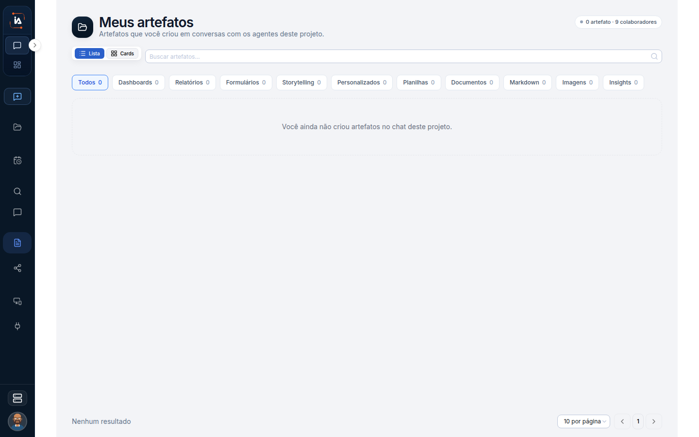

# Artefatos do chat

Artefato, nesta página, é o que a conversa produziu ou o que alguém compartilhou com você. Não é o catálogo de dashboards e relatórios do projeto. Se você procura o acervo da empresa, ele está em Artefatos de Operations. Se você procura o arquivo que o Copilot gerou ontem no chat, é aqui.

## Para que serve

Guarda o que nasceu ou foi recebido no chat. Não é o catálogo de artefatos do projeto.

## Quem vê

A pessoa dona do Copilot, e quem recebeu um compartilhamento. A lista Meus artefatos é sua. Compartilhado comigo só mostra o que outra pessoa enviou para você.

## Onde fica

Meus artefatos em `/chat/artifacts`. Compartilhado comigo em `/chat/artifacts/shared`.

## O que a tela mostra

O título é **Meus artefatos**. O canto marca **0 artefato**. O centro diz **Você ainda não criou artefatos no chat deste projeto.**

No menu, o grupo **Artefatos** tem duas listas:

* **Meus artefatos.** O que foi produzido nas conversas.
* **Compartilhado comigo.** O que outra pessoa compartilhou.

Um artefato aberto pelo chat volta ao cartão da conversa em que foi criado. Esse retorno importa porque o contexto do arquivo está na conversa, não numa ficha solta do projeto.


Se a definição de Studio não existir mais, a tela avisa para abrir de novo pelo cartão no chat.


Quando esse aviso aparece, o atalho direto da lista não reconstrói o artefato. O caminho é o cartão original da conversa.

## Campos

As duas listas. O detalhe de cada artefato abre a partir do cartão.

## O que dá para fazer

Abrir um artefato do chat e ver o que foi compartilhado.

<table data-view="cards"><thead><tr><th>Não é esta lista</th><th data-card-target data-type="content-ref">Abrir</th></tr></thead><tbody><tr><td><strong>Artefatos de Operations</strong> Catálogo do projeto, separado dos artefatos do chat.</td><td><a href="/operations/artefatos">artefatos</a></td></tr></tbody></table>

## Limite atual

A lista **Artefatos** da operação fica em Operations. Ela não é a caixa pessoal do Copilot. Publicar um artefato para o projeto, com nome, objetivo e design system, acontece no Studio aberto por uma tarefa, não nesta caixa.

## Dúvidas comuns

**Gerei um arquivo no chat e ele não está no catálogo do projeto.**
O chat guarda em Meus artefatos. O catálogo em `/artifacts` é o acervo do projeto. São duas listas. Um item **Não publicado** no catálogo também não é esta caixa: ele já está no acervo, só ainda não foi publicado.

**Alguém me mandou um artefato. Onde eu abro?**
Em Compartilhado comigo, em `/chat/artifacts/shared`. Ele não entra em Meus artefatos, porque não nasceu na sua conversa.

**A lista pediu para abrir pelo cartão no chat.**
A definição de Studio daquele artefato não existe mais. Abra de novo pelo cartão da conversa em que ele foi criado.
