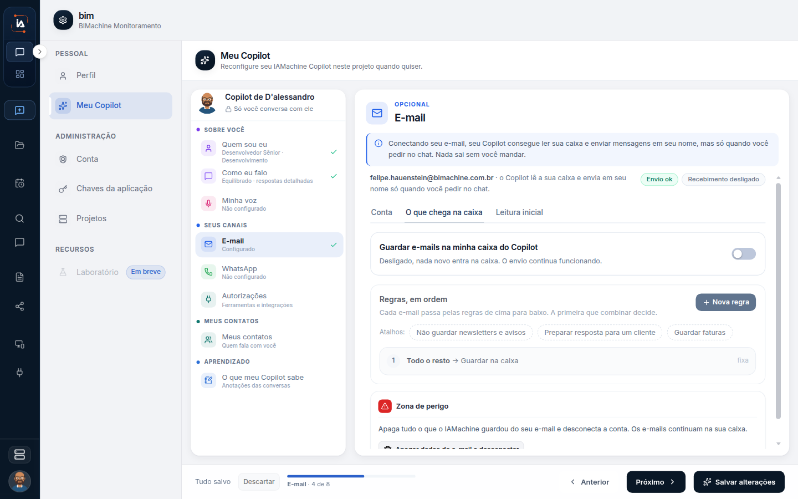

# E-mail

## Para que serve

O e-mail do Copilot lê a caixa e envia em nome da pessoa só quando ela pede no chat.

## Quem vê

A pessoa dona do Copilot.

## Onde fica

No primeiro acesso, em **Perfil › Meu Copilot**, e pelo botão **Conectar** na home do Copilot.

## O que a tela mostra

O e-mail do Copilot lê a sua caixa e envia em seu nome só quando você pede no chat.


Nada sai sozinho.


Dá para conectar no primeiro acesso ou depois, em **Perfil › Meu Copilot** e pelo botão **Conectar** na home do Copilot.

## Conectar a conta

A tela pede: "Entre com a conta do seu e-mail de trabalho".

* **Entrar com Google**
* **Usa outro provedor? Conectar por IMAP/SMTP**


**Entrar com Microsoft.** Hoje o botão aparece desabilitado, com a marca **em breve**.


No IMAP/SMTP, informe o e-mail, o nome de exibição e a senha. O nome de exibição é o nome que aparece para quem recebe. A senha pode ser uma senha de app, se a conta usa verificação em duas etapas. Para alterar uma conta já salva, deixe a senha em branco para manter a senha atual.

Os servidores ficam em dois blocos:

* **Envio (SMTP):** servidor, porta, segurança e usuário.
* **Recebimento (IMAP):** os mesmos campos. Dá para marcar **Usar senha diferente para receber**.

A tela avisa a combinação de segurança: SSL/TLS na porta 465 ou 993, ou STARTTLS na 587. O botão **Testar e salvar** testa envio e recebimento antes de gravar.


O sucesso aparece como "E-mail conectado: envio e recebimento funcionando."


O que o Copilot passa a poder fazer, no texto da própria tela:

* ler os e-mails para resumos e lembretes
* escrever respostas no seu tom, com a sua assinatura
* enviar em seu nome, só quando você pedir no chat

A assinatura vem do passo **Como eu falo**.


[Criar o Copilot no primeiro acesso](/comecar/meu-copilot)


## Estado da conta

Cada lado, envio e recebimento, aparece como:

* Funcionando
* Incompleto
* Desligado
* Com erro


**Recebimento incompleto** significa que falta o servidor de entrada. Sem ele, nada chega na caixa do Copilot. O botão **Completar recebimento** preenche os servidores e pede **Testar e salvar** de novo.


No Gmail, ler e enviar continuam funcionando. Para o Copilot agir na caixa (marcar como lido, arquivar, mover), use **Reconectar Gmail** e aceite a permissão nova.

**Trocar conta** troca o endereço conectado.

## O que entra na caixa

A seção **O que chega na caixa** tem:

* **Verificar novos e-mails.** A cada 5 minutos, 15 minutos, 30 minutos ou 1 hora.
* **Guardar e-mails na minha caixa do Copilot.** Desligado, nada novo entra. O envio continua funcionando.
* **Regras, em ordem.** Cada e-mail passa de cima para baixo. A primeira regra que combina decide.

Cada regra tem campo do e-mail, condição, conteúdo e ação. As ações são:

| Ação | O que acontece |
| --- | --- |
| Guardar na caixa | Entra na caixa do Copilot. Nada é feito sozinho. |
| Não guardar | Não entra. Serve para newsletters e avisos automáticos. |
| Guardar e preparar resposta | Entra com um rascunho para você revisar. Nada é enviado sozinho. |

A última regra é **Todo o resto** e fica fixa. Atalhos da tela criam regras prontas: **Não guardar newsletters e avisos**, **Preparar resposta para um cliente** e **Guardar faturas**.

## Leitura inicial

A **Leitura inicial** lê a caixa para sugerir pessoas, assuntos e termos do seu trabalho. Essas sugestões aparecem em **Com quem trabalho**, **Meus assuntos** e **Termos do meu trabalho**. Dá para acrescentar, marcar alguém como importante, excluir um contato ou desfazer a exclusão. Um contato excluído não volta na próxima leitura até você desfazer.


Sem e-mail conectado, a tela diz para conectar a caixa ou preencher à mão.


## Campos

Os campos de conexão, de IMAP/SMTP e das regras de caixa estão nas seções acima.

Na tela aberta, as abas são **Conta**, **O que chega na caixa** e **Leitura inicial**. Em **O que chega na caixa** estão **Guardar e-mails na minha caixa do Copilot**, **Regras, em ordem** e **Nova regra**. O estado desta conta aparece como **Envio ok** e **Recebimento desligado**.

## O que dá para fazer

Conectar com Google ou IMAP/SMTP, testar e salvar, e completar o recebimento.

## Limite atual

Nada sai sozinho. **Entrar com Microsoft** aparece desabilitado, com a marca **em breve**. Não há passo de uso para esse botão.

## Dúvidas comuns

**Conectei o e-mail. Ele vai responder os clientes sozinho?**
Não. A própria tela diz que o Copilot envia em seu nome só quando você pede no chat. A ação **Guardar e preparar resposta** cria um rascunho para você revisar. Nada é enviado sozinho.

**O envio funciona e o recebimento não.**
Isso é **Recebimento incompleto**: falta o servidor de entrada. Sem ele, nada chega na caixa do Copilot. Use **Completar recebimento** e **Testar e salvar** de novo. Desligar **Guardar e-mails na minha caixa do Copilot** também impede a entrada de novos e-mails, e o envio continua funcionando.

**Quero entrar com a conta Microsoft.**
O botão **Entrar com Microsoft** aparece desabilitado, com a marca **em breve**. O caminho disponível é Google ou IMAP/SMTP.

**Mudei a senha e a conta já estava salva.**
No IMAP/SMTP, deixe a senha em branco para manter a senha atual. Preencha uma senha nova só quando ela tiver mudado. Se a conta usa verificação em duas etapas, a senha pode ser uma senha de app.

**As regras não parecem valer juntas.**
Cada e-mail passa de cima para baixo. A primeira regra que combina decide. A última, **Todo o resto**, fica fixa e cobre o que nenhuma regra anterior pegou.
