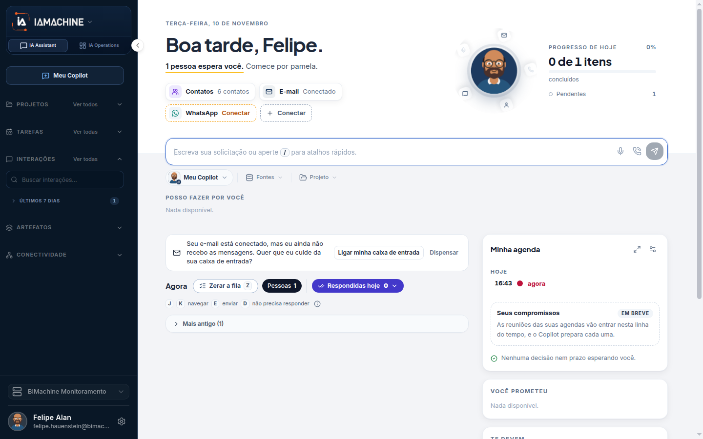

# Interações

Interações é o histórico vivo do Assistant. Não é uma tela com endereço próprio e não é a fila de Interações humanas da operação. Aquela fila espera uma decisão de alguém sobre um fluxo. Esta lista só ajuda você a reabrir uma conversa.

## Para que serve

Achar uma conversa já feita no Assistant.

## Quem vê

A pessoa dona das conversas.

## Onde fica

Lista viva no menu. Não é uma rota própria. “Ver todas” abre a lista completa.

## O que a tela mostra

O menu mostra **INTERAÇÕES**, a busca **Buscar interações...** e o grupo **ÚLTIMOS 7 DIAS**.

Busca, filtro por projeto e agrupamento por período. O projeto deste filtro é a pasta de conversas, não o seletor da empresa. O período agrupa o que é recente e o que ficou para trás, para você não depender só da busca.

## Campos

O texto da busca e o projeto usado no filtro.

## O que dá para fazer

Buscar, filtrar por projeto e abrir a lista completa. A conversa aberta volta para o chat, com o mesmo destinatário de quando ela foi feita.

## Limite atual

Não há uma rota própria para esta lista. Ela mora no menu do Assistant.

## Dúvidas comuns

**Não acho o endereço desta tela para mandar a alguém.**
Não existe. É uma lista do menu. A outra pessoa não vê as suas interações.

**Filtrei pelo projeto e sumiu uma conversa que eu lembro.**
O filtro usa a pasta de conversas. Uma conversa que está em outra pasta, ou em nenhuma, não entra nesse recorte. Limpe o filtro ou use só a busca.

**Esta lista é a fila de aprovações?**
Não. Aprovação, prazo e resposta de um fluxo ficam em Interações humanas, na aba IA Operations.
