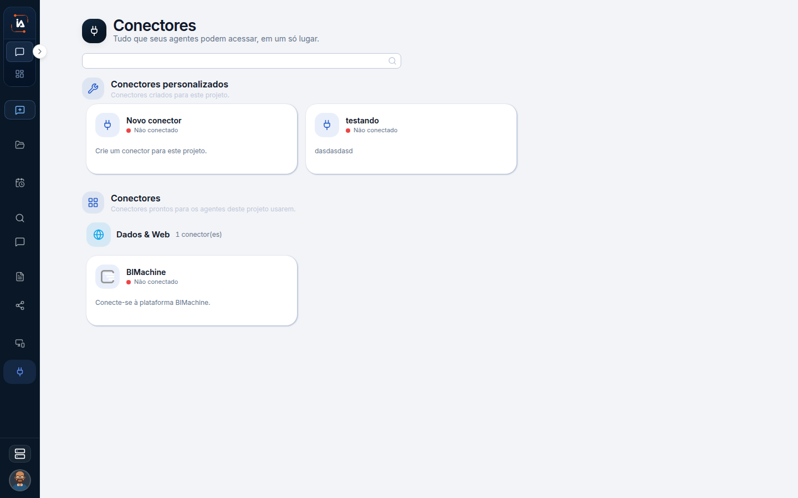

# Meus conectores

Meus conectores é a lista do que o seu Copilot pode usar. Ela não é o catálogo da empresa. Cadastrar uma ferramenta para o projeto inteiro continua em Conectores, na outra aba. Autorizar uma ferramenta no primeiro acesso do Copilot também é outro passo: escolhe o que aquele Copilot usa no chat e nas tarefas dele, sem cadastrar o conector no projeto.

## Para que serve

Lista os conectores que o Meu Copilot pode usar.

## Quem vê

Só administrador. Quem não administra a conta não vê a entrada, mesmo usando o chat todos os dias.

## Onde fica

`/my-connectors`.

## O que a tela mostra

O título é **Conectores**. O texto diz **Tudo que seus agentes podem acessar, em um só lugar.**

Os conectores da pessoa. A página de Operations, em `/connectors`, é o catálogo do projeto. Esta é a da pessoa.

As três listas convivem de propósito:

1. **Meus conectores.** O que o Meu Copilot pode usar.
2. **Conectores.** O catálogo do projeto, para ligar a ferramenta a um colaborador ou a uma tarefa.
3. **Autorizações**, no Meu Copilot. A escolha pessoal de ferramentas no chat e nas tarefas da pessoa.

Marcar uma ferramenta numa dessas listas não marca nas outras.

## Campos

A lista dos conectores que o Meu Copilot pode usar. O formulário de cada conector do catálogo fica na página de Conectores do projeto, e o preenchimento de cada ferramenta ainda não está descrito campo a campo.

## O que dá para fazer

Abrir os conectores que o Meu Copilot pode usar.

## Limite atual


Quem não é administrador não vê Meus conectores.



[Conectores](/operations/conectores)


## Dúvidas comuns

**Autorizei a ferramenta no primeiro acesso e ela não apareceu no catálogo do projeto.**
A autorização do Copilot não cadastra o conector da empresa. O catálogo é a página Conectores, em `/connectors`, e também pede administrador e um projeto selecionado.

**Uso o chat e não vejo esta entrada.**
Ela é de administrador. O chat, o e-mail e o WhatsApp do Copilot não dependem desta lista para existirem.

**O colaborador digital usa esta mesma lista?**
Não. O que aquele colaborador pode usar fica na seção Conectores da ficha dele, apontando para o catálogo do projeto.
