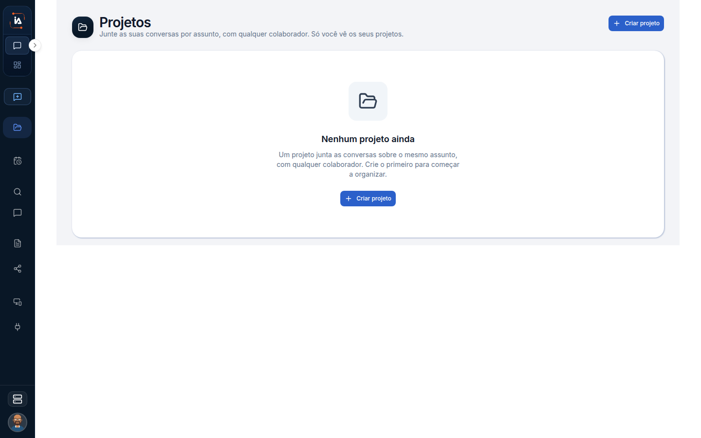

# Projetos

No Assistant, projeto é uma pasta das suas conversas. Serve para achar de novo um assunto, não para trocar o espaço da empresa. O projeto da empresa é o que você escolhe no menu lateral e que liga colaboradores, tarefas e conectores.

## Para que serve

Agrupa conversas da pessoa. No menu aparecem os 5 mais recentes, e “ver todos” abre a lista completa.

## Quem vê

A pessoa dona das conversas.

## Onde fica

`/chat/collections` e `/chat/collections/[id]`. No menu, os 5 mais recentes e “ver todos”.

## O que a tela mostra

O título é **Projetos**. O centro diz **Nenhum projeto ainda**.

A lista de projetos de conversa e, ao abrir um, as conversas que estão dentro dele. O nome é o que você deu à pasta. As conversas continuam sendo suas. Colocar uma conversa nesta pasta não a publica para o restante do projeto.

## Campos

Nome. A lista também mostra as conversas dentro do projeto. Criar pede esse nome. Abrir mostra o que já foi agrupado.

## O que dá para fazer

Criar e abrir. Use um projeto de conversa quando o mesmo assunto voltar várias vezes, por exemplo um cliente ou uma entrega. A busca das Interações também filtra por esse projeto.

## Limite atual

Esta lista é das conversas da pessoa. Não é o projeto da empresa escolhido no menu lateral. Trocar o projeto da empresa não é a mesma ação que abrir uma destas pastas.

## Dúvidas comuns

**Criei um projeto aqui e os colaboradores não apareceram.**
Esta pasta não cria o espaço da empresa. Colaboradores digitais dependem do projeto selecionado no menu lateral, e somem para Viewer.

**Os 5 nomes do menu não são todos os meus assuntos.**
O menu mostra os 5 mais recentes. “Ver todos” abre `/chat/collections`, com a lista inteira.

**Outra pessoa do projeto vê estas conversas?**
Não por esta lista. Ela é sua. O que você compartilha de propósito aparece para a outra pessoa em Compartilhado comigo, nos artefatos do chat.
