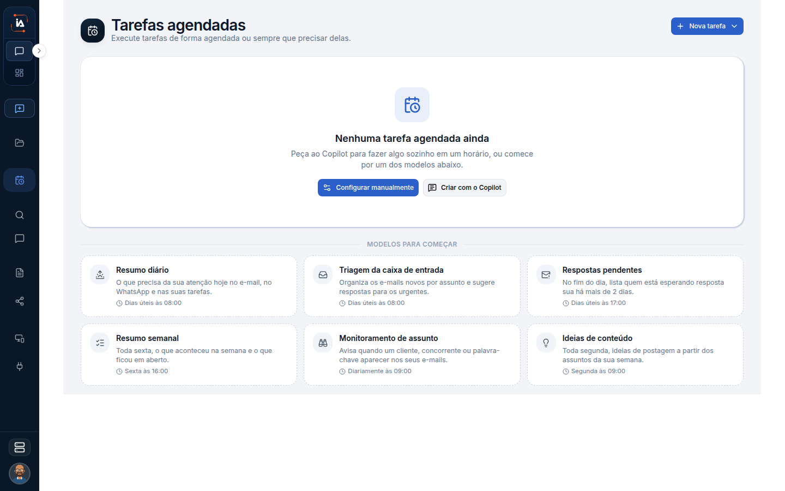

# Tarefas do Copilot

Esta é a agenda do seu Copilot, não a agenda da operação. Uma tarefa daqui é algo que você quer que o seu agente faça de novo, num horário, ou que dispare quando você pedir. A lista Tarefas de IA Operations pertence a um colaborador digital e tem fluxo, publicação e execuções do projeto.

## Para que serve

Tarefas que o Copilot da pessoa dispara. O texto da tela é: "Execute tarefas de forma agendada ou sempre que precisar delas."

## Quem vê

A pessoa dona do Copilot. Some sem projeto.


Sem projeto selecionado, a tela pede: "Selecione um projeto para ver as tarefas agendadas."


## Onde fica

`/chat/scheduled`.

## O que a tela mostra

O título é **Tarefas agendadas**. O centro diz **Nenhuma tarefa agendada ainda**.

Esta lista é sua. A lista **Tarefas** da operação, ligada a um colaborador digital, é outra lista.

O cartão mostra a última execução e o status, ou **Ainda não executou**, e a próxima data. Uma tarefa pode estar pausada ou concluída. Pausada deixa de disparar e continua na lista. Concluída chegou ao fim da duração que você escolheu. Um modelo alterado pelo administrador leva a marca **Personalizada pelo administrador**.

Se ainda não houver nenhuma, a tela mostra **Nenhuma tarefa agendada ainda** e **Modelos para começar**. O modelo é um ponto de partida. Ele pode exigir um canal. Sem esse canal, o modelo fica indisponível em vez de criar uma tarefa que não conseguiria enviar.

## Campos

O que fazer, quando roda e o que já rodou. O campo **Duração** define até quando a tarefa continua: Permanente, Até uma data, Por N vezes ou Até atingir um objetivo.

| Opção | O que a tela explica |
| --- | --- |
| Permanente | Roda até você pausar ou excluir. |
| Até uma data | Roda até o fim do dia escolhido, no horário de Brasília, e se encerra sozinha. A data não pode estar no passado. |
| Por N vezes | Encerra depois desse número de execuções do agendamento, entre 1 e 365. Executar agora não conta. |
| Até atingir um objetivo | A cada execução o Copilot confere se o objetivo aconteceu. Quando acontece, ele avisa e encerra a tarefa. |

A duração não substitui o horário. Ela diz quando a série acaba. Uma tarefa manual, sem frequência, não aceita duração: a tela pede uma frequência para limitar o ciclo.

## O que dá para fazer

**Nova tarefa** abre **Criar com o Copilot** ou **Configurar manualmente**. As ações do cartão são **Executar agora**, **Pausar**, **Ativar**, **Editar** e excluir. Dá para buscar por nome e ordenar por **Próxima execução**, **Nome** ou **Mais recentes**.

**Criar com o Copilot** abre o chat com o pedido: "Quero agendar uma tarefa recorrente com você. Me ajude a definir o que fazer, quando e como me avisar." Você combina o conteúdo na conversa em vez de preencher o formulário primeiro.

**Executar agora** inicia na hora e abre a conversa. Essa execução manual não conta para o limite de vezes da duração. Serve para testar sem consumir uma das N execuções.

## Limite atual


Um modelo pode exigir e-mail ou WhatsApp conectado. Sem o canal, ele aparece como indisponível.



Uma tarefa manual, sem frequência, não tem duração. A tela pede uma frequência para limitar o ciclo.



[Tarefas](/operations/tarefas)


## Dúvidas comuns

**A tarefa não aparece.**
Selecione um projeto. Sem projeto, a tela nem carrega a lista. Viewer e a falta de projeto também escondem outros itens, mas esta mensagem é específica: "Selecione um projeto para ver as tarefas agendadas."

**Executei agora e o contador de vezes não andou.**
Executar agora não conta para **Por N vezes**. Só a execução do agendamento entra nesse número.

**Pausei. Perdi a tarefa?**
Não. Pausar tira os próximos disparos e mantém o cartão. Ativar devolve a tarefa à fila. Excluir é outra ação.

**O modelo está indisponível.**
Ele pede e-mail ou WhatsApp, e o canal não está conectado. Conecte o canal no Meu Copilot. Conectar não faz a tarefa enviar sozinha: o envio do canal continua dependendo do pedido no chat, e a tarefa segue a regra que você gravou nela.

**Isto é a mesma agenda do colaborador digital?**
Não. A agenda da operação fica em Tarefas, em IA Operations, pede um colaborador digital e abre um fluxo.
