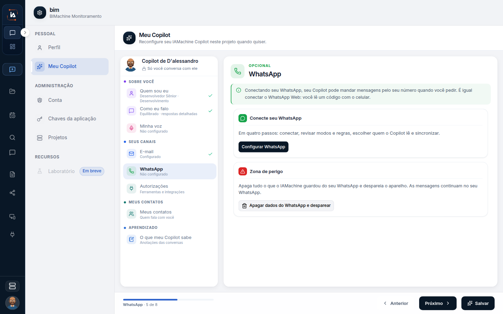

# WhatsApp

## Para que serve

O WhatsApp do Copilot envia mensagens pelo número da pessoa quando ela pede no chat.

## Quem vê

A pessoa dona do Copilot.

## Onde fica

No primeiro acesso, em **Perfil › Meu Copilot**, e pelo botão **Conectar** na home do Copilot.

## O que a tela mostra

O WhatsApp do Copilot envia mensagens pelo seu número quando você pede no chat. A conexão é a mesma do WhatsApp Web.

Dá para conectar no primeiro acesso ou depois, em **Perfil › Meu Copilot** e pelo botão **Conectar** na home do Copilot.

## Conectar

A tela pede para ler o código com o celular, nesta ordem:

1. Abra o WhatsApp no seu celular.
2. Toque em **Aparelhos conectados**.
3. Toque em **Conectar aparelho** e aponte para o código.


Quando a leitura termina, a plataforma confirma "WhatsApp conectado." Se o número vier na conta, a frase inclui o telefone.


## O que a conta mostra

Depois de conectado, a tela pode mostrar:

* o aparelho: Android, iPhone ou outro
* o tipo: conta pessoal ou WhatsApp Business
* recado, categoria, site, e-mail e endereço, quando a conta tiver esses dados

**Trocar** inicia outra conexão.


Se a desconexão falhar, a mensagem é: "Não foi possível desconectar agora. Tente de novo."


## O que ele pode enviar


O Copilot manda mensagem pelo número conectado quando você pede no chat. O envio não acontece sozinho.


Tarefas agendadas que dependem de WhatsApp só aparecem como disponíveis quando este canal está conectado.


[Tarefas do Copilot](tarefas.md)


## Campos

O código lido pelo celular e os dados da conta, quando a tela os mostra, estão nas seções acima.

A linha do canal mostra **Não configurado**. A tela traz **Conecte seu WhatsApp** e o botão **Configurar WhatsApp**.

## O que dá para fazer

Conectar, trocar e desconectar.

## Limite atual

O envio não acontece sozinho. Tarefas agendadas que dependem de WhatsApp só ficam disponíveis com este canal conectado.

## Dúvidas comuns

**Ler o código autoriza o Copilot a falar com os meus contatos?**
A conexão é a mesma do WhatsApp Web: o celular mostra o código e você confirma em Aparelhos conectados. O envio pelo número conectado só acontece quando você pede no chat.

**A tarefa de WhatsApp não aparece para agendar.**
Modelos e tarefas que dependem deste canal só ficam disponíveis com ele conectado. Conecte primeiro e volte em Tarefas do Copilot.

**Troquei de aparelho.**
Use **Trocar** para iniciar outra conexão e leia o código de novo. Se a desconexão falhar, a mensagem é: "Não foi possível desconectar agora. Tente de novo."

**Isto é o WhatsApp do colaborador digital?**
Não. Este número é o do seu Copilot. O WhatsApp de um colaborador da operação fica na ficha dele, com conexão, regras, usuários autorizados e teste de envio.
