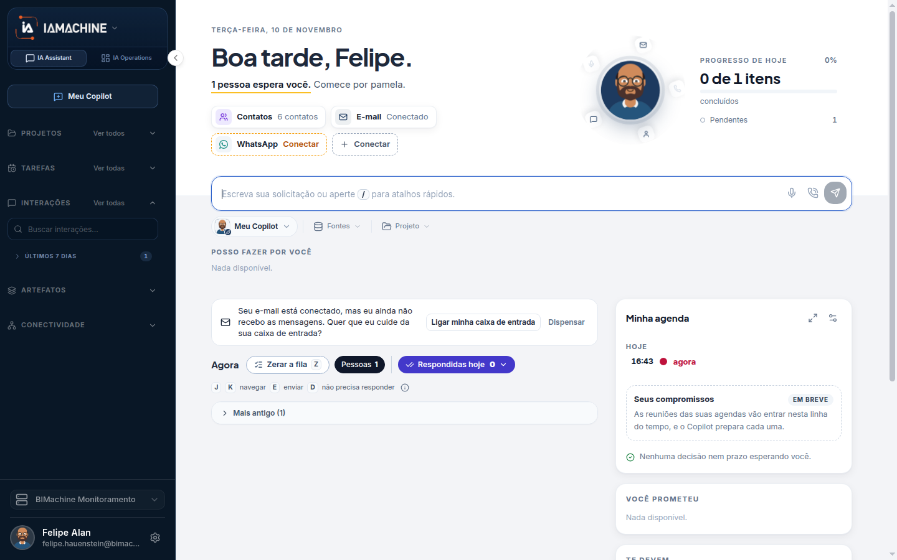
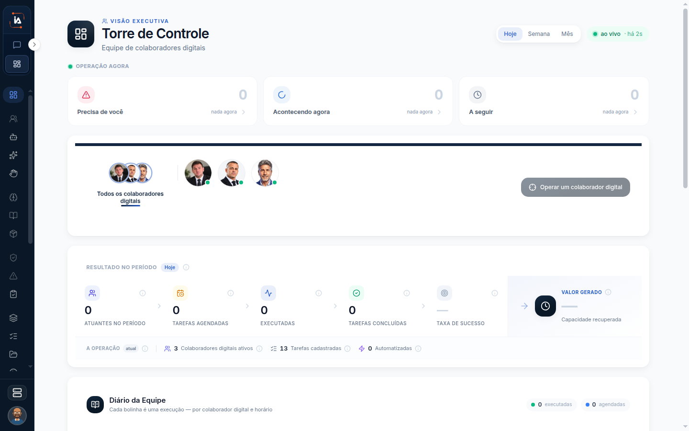

# O que é o IAMachine

O IAMachine é a plataforma em que a empresa conversa com agentes e, no mesmo lugar, organiza o trabalho que esses agentes executam. A conta tem dois ambientes. Um é o dia a dia de cada pessoa. O outro é a operação: quem executa, o que foi pedido, o que rodou e o que ficou de resultado.

## Para que serve

O **IA Assistant** é o chat com o **Meu Copilot** e com os **colaboradores digitais**. Você pede, anexa, continua uma conversa e recebe o que o agente produziu.

O **IA Operations** é onde se configura gente digital, tarefa, execução e resultado. É o lado em que a empresa desenha o trabalho, acompanha se ele rodou e guarda o que foi produzido para o projeto.

Um **projeto** é o espaço da empresa dentro da conta. Colaboradores, tarefas, conectores e auditoria pertencem ao projeto que está aberto. Trocar de projeto troca esse conjunto.

## Quem vê

Qualquer pessoa que entra na conta vê as duas abas. O que aparece dentro delas depende do papel e de haver um projeto selecionado. Quem é Viewer não vê Colaboradores digitais. Quem não é administrador não vê as telas de administração.

## Onde fica

A documentação começa nesta página. No produto, a aba da esquerda abre o Assistant e a da direita abre o Operations.

## O que a tela mostra

A primeira figura mostra **IA Assistant**, **IA Operations** e a caixa, com **Boa tarde, Felipe.** A segunda mostra **Torre de Controle**, período **Hoje** e **ao vivo**.

Três nomes parecem a mesma coisa e não são:

* **Meu Copilot** é o agente do dia a dia de uma pessoa. Só essa pessoa conversa com ele. A conversa é privada. Nem os administradores do projeto veem essa conversa.
* **Colaborador digital** é o agente da operação. Ele entra na lista do projeto, recebe tarefa e aparece na Torre de Controle.
* **Copilot do projeto** é outra lista, em Copilots. Também não é o Meu Copilot.

## Campos

Esta página não tem formulário.

## O que dá para fazer

Escolher por onde continuar, conforme a dúvida que você tem agora.

<table data-view="cards"><thead><tr><th>Por onde continuar</th><th data-card-target data-type="content-ref">Abrir</th></tr></thead><tbody><tr><td><strong>Os dois ambientes</strong> A aba da esquerda abre em /chat. A da direita abre em /central.</td><td><a href="ambientes.md">ambientes</a></td></tr><tr><td><strong>Entrar, projeto e papéis</strong> Viewer não vê Colaboradores digitais. Sem projeto, algumas telas somem.</td><td><a href="entrar.md">entrar</a></td></tr><tr><td><strong>Meu Copilot</strong> Quem sou eu e Como eu falo liberam o Copilot. Voz, e-mail e WhatsApp podem ficar para depois.</td><td><a href="meu-copilot.md">meu-copilot</a></td></tr><tr><td><strong>Torre de Controle</strong> Período Hoje, Semana ou Mês, e o filtro por colaborador digital.</td><td><a href="/operations/torre-de-controle">torre-de-controle</a></td></tr></tbody></table>

## Limite atual

O ícone de Help e a integração com chamados ainda não entram nesta wiki.

## Dúvidas comuns

**O chat e a Torre são produtos diferentes?**
Não. São as duas abas da mesma conta. A da esquerda é onde você conversa. A da direita é onde a operação aparece.

**Posso usar a plataforma sem criar um colaborador digital?**
Sim. O Meu Copilot já atende o dia a dia no chat. O colaborador digital existe quando a empresa quer um agente da operação, com tarefa, agenda e acompanhamento.
