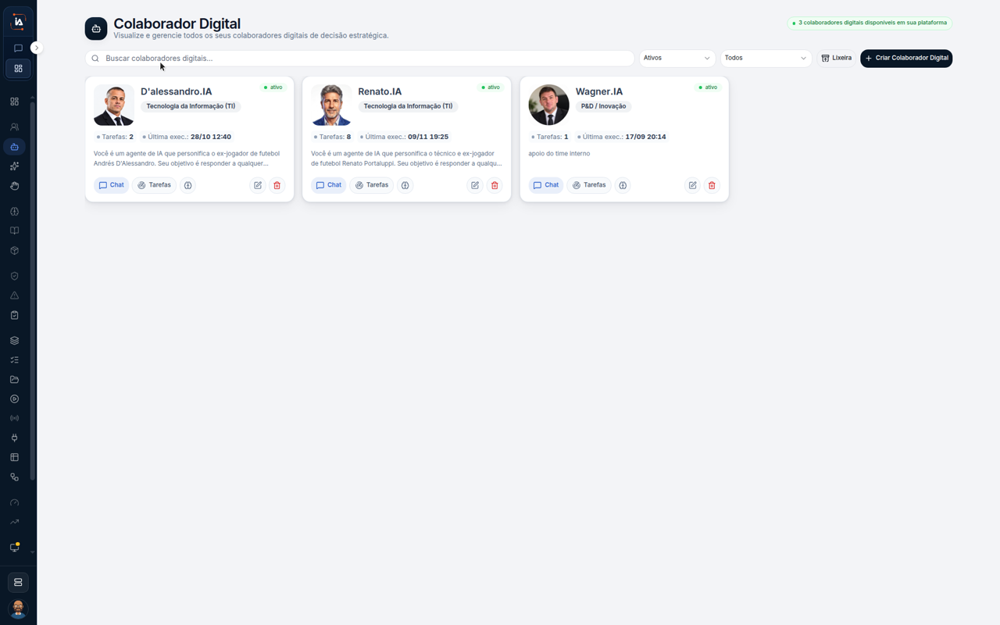

# Achar um colaborador

**Colaboradores digitais** lista quem trabalha no projeto. Este percurso para na lista. Não abre o card, não clica em **Chat** nem em **Tarefas**, e não cria colaborador.



## Abra a lista

Na aba **IA Operations**, em **Força de trabalho**, clique em **Colaboradores digitais**.

O título é **Colaborador Digital**. O texto debaixo é **Visualize e gerencie todos os seus colaboradores digitais de decisão estratégica.** O canto marca **3 colaboradores digitais disponíveis em sua plataforma**.

A busca diz **Buscar colaboradores digitais...** O filtro ao lado está em **Ativos**. O outro filtro está em **Todos**. À direita ficam **Lixeira** e **Criar Colaborador Digital**. Este percurso não usa esses botões.

Os três cards deste print estão **ativo**:

| Card | Área | Tarefas | Última exec. | Botões |
| --- | --- | --- | --- | --- |
| **D'alessandro.IA** | **Tecnologia da Informação (TI)** | **2** | **28/10 12:40** | **Chat**, **Tarefas** |
| **Renato.IA** | **Tecnologia da Informação (TI)** | **8** | **09/11 19:25** | **Chat**, **Tarefas** |
| **Wagner.IA** | **P&D / Inovação** | **1** | **17/09 20:14** | **Chat**, **Tarefas** |

Cada card também mostra ícones de informação, de editar e de excluir. O texto debaixo da contagem fica cortado na borda do card. Esta página não completa esse texto.



## Limite deste percurso

A busca, o filtro **Ativos** e os botões do card aparecem na tela. O passo a passo não digita na busca, não troca o filtro e não clica no card. **Criar Colaborador Digital** e **Lixeira** também ficam sem clique.

## Dúvidas comuns

O canto conta **3 colaboradores digitais disponíveis em sua plataforma**. Os três cards visíveis estão **ativo**, com **Chat** e **Tarefas** em cada um.

<table data-view="cards"><thead><tr><th>Página</th><th data-card-target data-type="content-ref">Abrir</th></tr></thead><tbody><tr><td><strong>Colaboradores digitais</strong> Lista os agentes da operação do projeto, para visualizar e gerenciar.</td><td></td></tr></tbody></table>
