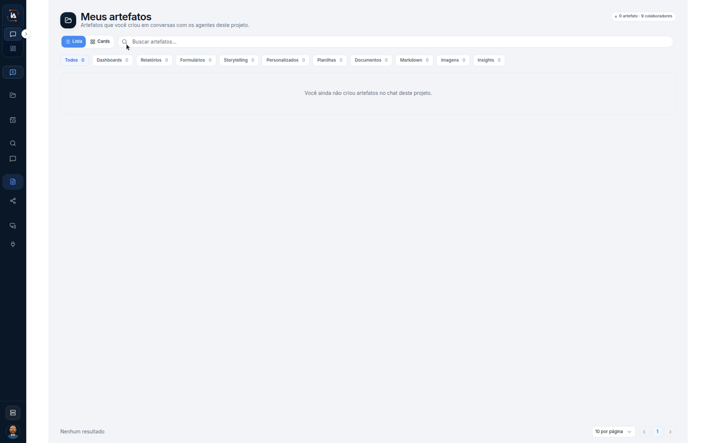

# Artefatos da conversa

**Meus artefatos** é a lista do que você criou no chat deste projeto. Este percurso fica nessa lista. Não abre um artefato, porque a lista deste print está vazia.



## Abra Meus artefatos

Na aba **IA Assistant**, abra **Meus artefatos**.

O título é **Meus artefatos**. O texto debaixo é **Artefatos que você criou em conversas com os agentes deste projeto.** O canto marca **0 artefato** e **0 colaboradores**.

A vista marcada é **Lista**. Ao lado está **Cards**. A busca diz **Buscar artefatos...**

As abas, todas em zero neste print:

| Aba | Contagem |
| --- | --- |
| **Todos** | **0** |
| **Dashboards** | **0** |
| **Relatórios** | **0** |
| **Formulários** | **0** |
| **Storytelling** | **0** |
| **Personalizados** | **0** |
| **Planilhas** | **0** |
| **Documentos** | **0** |
| **Markdown** | **0** |
| **Imagens** | **0** |
| **Insights** | **0** |

O centro diz **Você ainda não criou artefatos no chat deste projeto.** O rodapé diz **Nenhum resultado** e **10 por página**. A página **1** está aberta.



## Limite deste percurso

A vista é **Lista**. **Cards** aparece e não é aberto. A busca fica vazia. Nenhuma aba é trocada, porque todas estão em **0**.

## Dúvidas comuns

O canto marca **0 artefato** e **0 colaboradores**. A frase do centro é **Você ainda não criou artefatos no chat deste projeto.** O rodapé repete **Nenhum resultado**.

<table data-view="cards"><thead><tr><th>Página</th><th data-card-target data-type="content-ref">Abrir</th></tr></thead><tbody><tr><td><strong>Artefatos do chat</strong> Guarda o que nasceu ou foi recebido no chat.</td><td><a href="https://ia-machine.gitbook.io/ia-machine-docs/assistant/ia-assistant/artefatos">https://ia-machine.gitbook.io/ia-machine-docs/assistant/ia-assistant/artefatos</a></td></tr></tbody></table>
