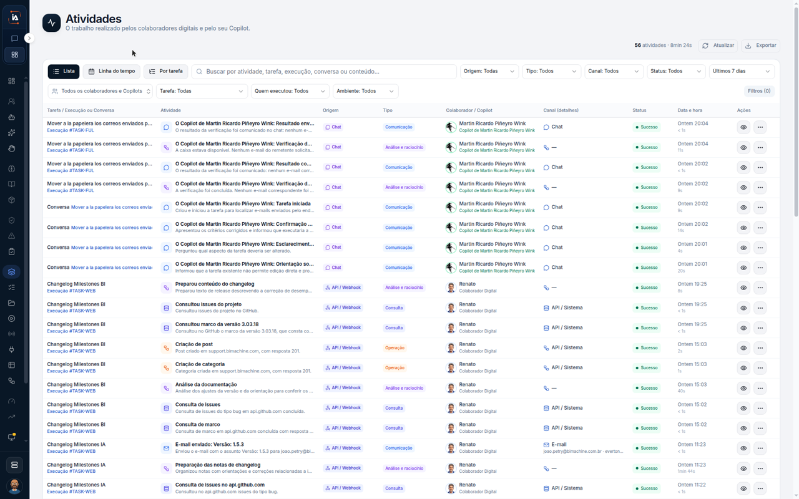

# Atividades

**Atividades** lê o trabalho que a operação já fez. Não é a lista **Execuções**. Esse outro percurso está em [Ver o histórico de execuções](ver-execucoes.md). Aqui o passo a passo não abre uma linha e não exporta a lista.



## Abra Atividades

Na aba **IA Operations**, em **Orquestração e execução**, clique em **Atividades**.

O título é **Atividades**. O texto debaixo é **O trabalho realizado pelos colaboradores digitais e pelo seu Copilot.** O canto marca **56 atividades** e **8min 24s**, com os botões **Atualizar** e **Exportar**.

A vista marcada é **Lista**. Ao lado estão **Linha do tempo** e **Por tarefa**. A busca diz **Buscar por atividade, tarefa, execução, conversa ou conteúdo...**

Os filtros deste print:

| Filtro | Neste print |
| --- | --- |
| Origem | **Todas** |
| Tipo | **Todos** |
| Canal | **Todos** |
| Status | **Todos** |
| Período | **Últimos 7 dias** |
| Pessoas | **Todos os colaboradores e Copilots** |
| Tarefa | **Todas** |
| Quem executou | **Todos** |
| Ambiente | **Todos** |
| Filtros | **Filtros (0)** |

As colunas são **Tarefa / Execução ou Conversa**, **Atividade**, **Origem**, **Tipo**, **Colaborador / Copilot**, **Canal (detalhes)**, **Status**, **Data e hora** e **Ações**.

Nas linhas visíveis, **Status** está **Sucesso** e **Data e hora** está em **Ontem**. As primeiras linhas trazem **Martin Ricardo Piñeyro Wink**, com **Origem** **Chat** e **Canal (detalhes)** **Chat**. Mais abaixo aparecem **Changelog Milestones BI** e **Changelog Milestones IA**, com **Renato** e **Colaborador Digital**. Nessas linhas a **Origem** mostra **API / Webhook**, e uma linha mostra o canal **E-mail**.

Vários nomes de tarefa e textos de atividade ficam cortados na coluna. Esta página não completa o que a borda esconde. Os ícones de **Ações** aparecem e não são clicados.



## Limite deste percurso

A vista deste print é **Lista**. **Linha do tempo** e **Por tarefa** aparecem e não são abertos. **Atualizar** e **Exportar** também ficam sem clique. O período marcado é **Últimos 7 dias**.

## Dúvidas comuns

O canto soma **56 atividades** e **8min 24s**. A coluna se chama **Tarefa / Execução ou Conversa**: cada linha aponta a execução ou a conversa daquela atividade. A lista do que a tarefa executou, com o estado **Concluído**, é o outro menu, **Execuções**.

<table data-view="cards"><thead><tr><th>Página</th><th data-card-target data-type="content-ref">Abrir</th></tr></thead><tbody><tr><td><strong>Atividades</strong> Mostra o que a operação fez no período.</td><td><a href="https://ia-machine.gitbook.io/ia-machine-docs/operations/orquestracao/atividades">https://ia-machine.gitbook.io/ia-machine-docs/operations/orquestracao/atividades</a></td></tr></tbody></table>
