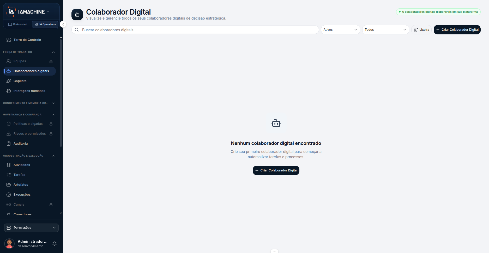
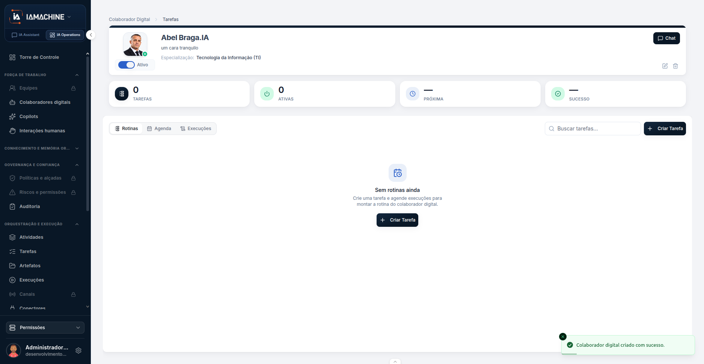
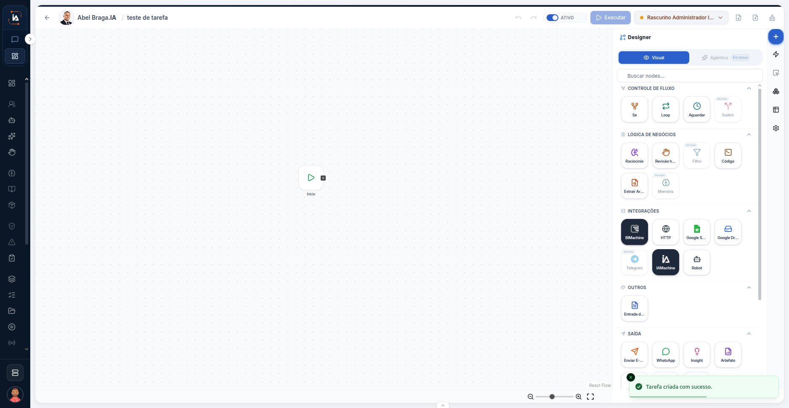
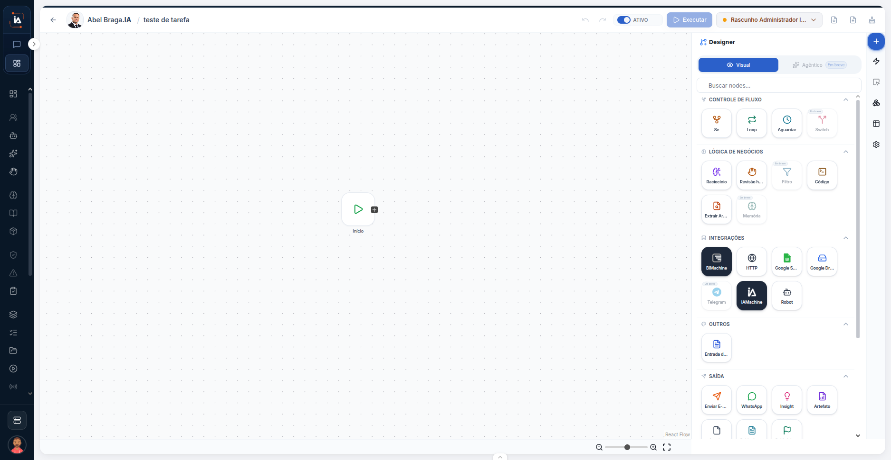
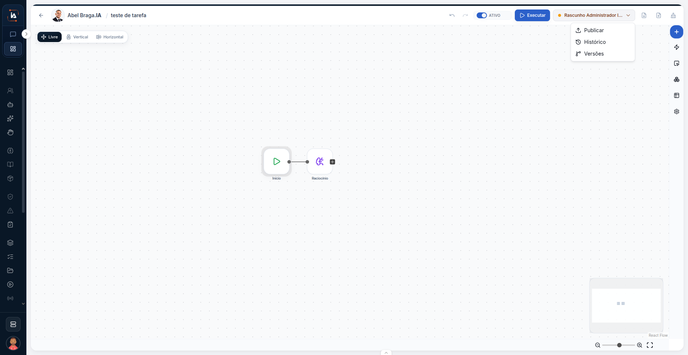
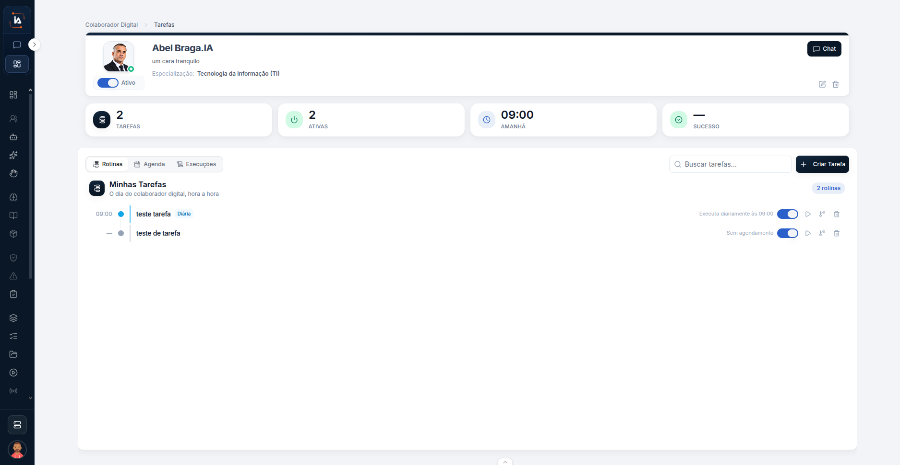

# Colaborador e primeira tarefa

O [Primeiro acesso](comecar/primeiro-acesso.md) cria o Meu Copilot e abre o chat. O colaborador da operação é outra pessoa digital. Ele fica na aba **IA Operations**, entra na lista de **Colaboradores digitais** e recebe as tarefas do projeto. Este percurso começa com a lista vazia, cria um colaborador e para na rotina dele, com a próxima execução já preenchida.

O Meu Copilot não entra nessa lista. A conversa privada continua no **IA Assistant**.


Os formulários da ficha e da tarefa não aparecem nestas telas. O que este percurso mostra é a lista, o colaborador já salvo, o editor do fluxo e a rotina. O cadastro campo a campo continua nas páginas de referência, no fim.




## Abra Colaboradores digitais

Na barra de cima, a aba **IA Operations** é a da operação. **IA Assistant**, ao lado, continua sendo o chat. No menu, **Colaboradores digitais** fica em **Força de trabalho**, debaixo de **Torre de Controle**. Neste percurso o projeto marcado é **Permissões**. O mesmo nome volta no bloco de baixo, acima do usuário.

A tela se chama **Colaborador Digital**. O texto debaixo do título diz: **Visualize e gerencie todos os seus colaboradores digitais de decisão estratégica.**

No alto, à direita, o selo verde diz **0 colaboradores digitais disponíveis em sua plataforma**. A lista ainda não tem ninguém. O centro repete isso:

* **Nenhum colaborador digital encontrado**
* **Crie seu primeiro colaborador digital para começar a automatizar tarefas e processos.**

O que dá para usar antes de criar:

| Controle | O que mostra |
| --- | --- |
| Buscar colaboradores digitais... | Campo de busca. Nesta tela vazia não há nome para achar. |
| Ativos | Filtro da lista. Não é o nome de um colaborador. |
| Todos | O outro filtro, ao lado de **Ativos**. |
| Lixeira | Botão ao lado dos filtros. |
| + Criar Colaborador Digital | Aparece no alto e de novo no centro da lista vazia. |

Não há cartão de colaborador neste passo. **Ativos** é só o filtro. Clique em **+ Criar Colaborador Digital**.



## Veja o colaborador criado

Depois de salvar, a plataforma abre a página desse colaborador. O breadcrumb diz **Colaborador Digital > Tarefas**. O aviso verde, no canto, confirma: **Colaborador digital criado com sucesso.**

Neste exemplo o cabeçalho mostra:

| O que aparece | Neste exemplo |
| --- | --- |
| Nome | **Abel Braga.IA** |
| Linha debaixo do nome | um cara tranquilo |
| Especialização | Tecnologia da Informação (TI) |
| Interruptor | **Ativo**, ligado |
| Chat | Botão no canto direito do cabeçalho |

Quatro contadores ficam embaixo do nome. Os quatro ainda estão vazios:

| Contador | Neste momento |
| --- | --- |
| TAREFAS | 0 |
| ATIVAS | 0 |
| PRÓXIMA | traço |
| SUCESSO | traço |

A área de baixo tem três abas: **Rotinas**, **Agenda** e **Execuções**. **Rotinas** é a que está aberta. A busca pede **Buscar tarefas...**. O botão **+ Criar Tarefa** fica na busca e de novo no centro.

O centro diz **Sem rotinas ainda.** e, em seguida: **Crie uma tarefa e agende execuções para montar a rotina do colaborador digital.**

Dois ícones ficam no cabeçalho, ao lado de **Chat**. Este percurso não abre o que eles fazem. Clique em **+ Criar Tarefa**.



## A tarefa abre no editor

A tela seguinte já é o desenho da tarefa. Não é um formulário. O aviso verde diz **Tarefa criada com sucesso.**

O cabeçalho liga o colaborador à tarefa. Neste exemplo: **Abel Braga.IA / teste de tarefa**. O interruptor **ATIVO** está ligado. O botão **Executar** fica ao lado. O controle da direita mostra **Rascunho** e o começo de um nome, cortado nesta tela. Um ponto laranja marca esse controle.

O canvas, a área pontilhada, tem um único bloco: **Início**. Não há linha saindo dele. Não há segundo bloco.

À direita, o painel **Designer** está aberto. **Visual** está marcado. **Agêntica** aparece como **Em breve**: o nome está na tela e este percurso não usa esse modo. A busca do painel pede **Buscar nodes...**.

A paleta lista os blocos por grupo. Alguns nomes ficam cortados na borda. Os que se leem por inteiro são estes:

| Grupo | Nomes legíveis |
| --- | --- |
| CONTROLE DE FLUXO | Se, Loop, Aguardar, Switch |
| LÓGICA DE NEGÓCIOS | Raciocínio, Filtro, Código, Memória |
| INTEGRAÇÕES | BIMachine, HTTP, Telegram, IAMachine, Robot |
| OUTROS | O grupo está aberto. O nome do bloco fica cortado. |
| SAÍDA | WhatsApp, Insight, Artefato |

Cada bloco da paleta é um tipo de passo. Este percurso não configura nenhum deles. O único bloco no canvas continua sendo **Início**.



## Confira o canvas antes de ligar

A paleta segue aberta e o aviso de criação some. O resto da tela é o mesmo: **Abel Braga.IA / teste de tarefa**, **ATIVO** ligado, **Executar**, **Rascunho** e o painel **Designer** em **Visual**.

O canvas continua com um único **Início**, sem linha e sem outro bloco. Neste print o caminho ainda não saiu do **Início**.



## Ligue o Início e abra Publicar

No print seguinte o caminho já existe. **Início** está ligado, por uma linha, ao bloco **Raciocínio**. A paleta está fechada.

No alto do canvas há três jeitos de organizar o desenho: **Livre**, **Vertical** e **Horizontal**. **Livre** é o que está marcado.

O menu aberto no controle do **Rascunho** mostra três ações:

* **Publicar**
* **Histórico**
* **Versões**

**Publicar** está visível. Este percurso para aqui, antes de confirmar. A tela não mostra um diálogo de confirmação. **Executar** continua no cabeçalho, e o interruptor **ATIVO** continua ligado. No canto inferior há um retângulo com o desenho reduzido. Este percurso não mexe nele.

O bloco ligado ao **Início** é **Raciocínio**. O papel desse bloco, e o do **Início**, está nas páginas de referência do fluxo. Esta página não repete a configuração.



## Volte para a rotina

A página do colaborador volta com o breadcrumb **Colaborador Digital > Tarefas**. O cabeçalho continua **Abel Braga.IA**, com **um cara tranquilo**, **Especialização: Tecnologia da Informação (TI)**, o interruptor **Ativo** ligado e o botão **Chat**.

Os contadores agora contam o que foi criado:

| Contador | Neste exemplo |
| --- | --- |
| TAREFAS | 2 |
| ATIVAS | 2 |
| PRÓXIMA | **09:00**, com **AMANHÃ** embaixo |
| SUCESSO | traço |

A aba aberta continua **Rotinas**. **Agenda** e **Execuções** seguem ao lado, sem abrir neste percurso. A busca continua **Buscar tarefas...** e o botão **+ Criar Tarefa** continua no canto. A marca **2 rotinas** fica perto desse botão.

O bloco **Minhas Tarefas** traz o texto **O dia do colaborador digital, hora a hora**. Há duas linhas, as duas com o nome **teste de tarefa**:

| Linha | O que a tela mostra |
| --- | --- |
| 09:00 | **teste de tarefa**, com a marca **Diária**. À direita: **Executa diariamente às 09:00**. O interruptor dessa linha está ligado. |
| traço, sem hora | **teste de tarefa** de novo. À direita: **Sem agendamento**. O interruptor dessa linha também está ligado. |

A linha das **09:00** é a que preenche **PRÓXIMA** com **09:00** e **AMANHÃ**. A linha **Sem agendamento** não coloca hora na coluna da esquerda. **SUCESSO** segue com traço, como estava quando não havia tarefa.

Cada linha tem um botão de play e um ícone de lixeira. Este percurso não abre esses controles. A barra de endereço não aparece nestes prints. O lugar visível é o breadcrumb **Colaborador Digital > Tarefas**.



## Limite deste percurso

Sem projeto selecionado, **Colaboradores digitais** não é a lista deste exemplo. O projeto marcado aqui é **Permissões**.

**Agêntica** fica **Em breve** no **Designer**. Não há uso neste percurso.

O menu mostra **Publicar**, **Histórico** e **Versões**. Abrir o menu não confirma a publicação. A tela deste percurso não mostra o passo seguinte a **Publicar**.

A ficha, o formulário da tarefa, a voz, o e-mail e o WhatsApp ficam de fora. Não há print desses formulários nesta leva.

## Dúvidas comuns

Criei o Meu Copilot e ele não está em **Colaboradores digitais**. A lista deste percurso começa vazia de propósito. O Meu Copilot fica no **IA Assistant**. O colaborador da operação é o que nasce em **+ Criar Colaborador Digital**.

O aviso verde sumiu. **Colaborador digital criado com sucesso.** aparece na página do colaborador, logo depois de salvar. **Tarefa criada com sucesso.** aparece no editor, na primeira vez que a tarefa abre. Os dois são avisos daquele momento. A tela seguinte já não os mostra.

O canvas só tem **Início**. É o que os dois prints do editor mostram antes da ligação. No print seguinte, a linha sai do **Início** e chega em **Raciocínio**.

**PRÓXIMA** ficou em **09:00** **AMANHÃ**. Neste exemplo há duas rotinas com o mesmo nome, **teste de tarefa**. A que tem **Diária** e **Executa diariamente às 09:00** é a que preenche **PRÓXIMA**. A outra diz **Sem agendamento** e não tem hora na coluna.

**SUCESSO** continua com traço. O contador está assim no colaborador recém-criado e continua assim nesta rotina. **TAREFAS** e **ATIVAS** é que passam de 0 para 2.

## Onde continuar

<table data-view="cards"><thead><tr><th>Página</th><th data-card-target data-type="content-ref">Abrir</th></tr></thead><tbody><tr><td><strong>Colaboradores digitais</strong> Lista os agentes da operação do projeto, para visualizar e gerenciar.</td><td></td></tr><tr><td><strong>Ficha do colaborador</strong> Cria ou edita o colaborador digital.</td><td></td></tr><tr><td><strong>Rotina do colaborador</strong> Mostra a rotina de um colaborador digital já aberto.</td><td></td></tr><tr><td><strong>Tarefas</strong> Organiza, agenda e acompanha o trabalho dos colaboradores digitais.</td><td><a href="https://ia-machine.gitbook.io/ia-machine-docs/operations/orquestracao/tarefas">https://ia-machine.gitbook.io/ia-machine-docs/operations/orquestracao/tarefas</a></td></tr><tr><td><strong>Editor de fluxo</strong> Desenha os passos da tarefa. Cada bloco se chama nó.</td><td><a href="https://ia-machine.gitbook.io/ia-machine-docs/operations/orquestracao/tarefas/fluxo">https://ia-machine.gitbook.io/ia-machine-docs/operations/orquestracao/tarefas/fluxo</a></td></tr></tbody></table>
