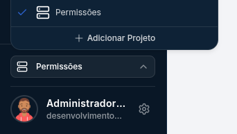
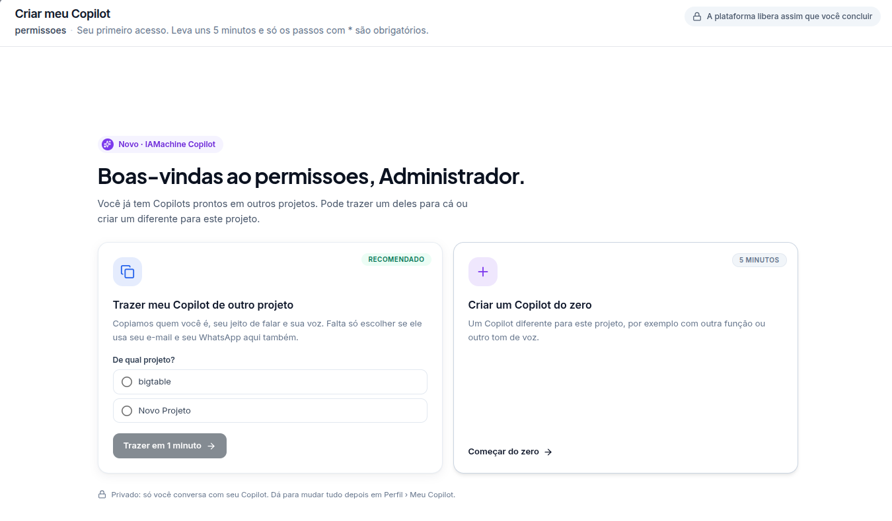
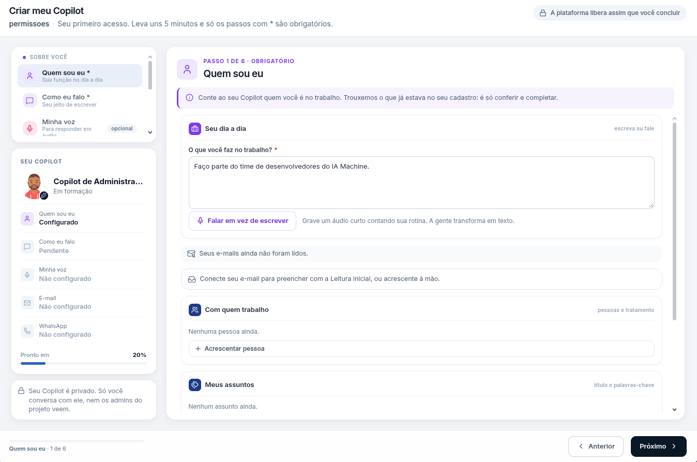
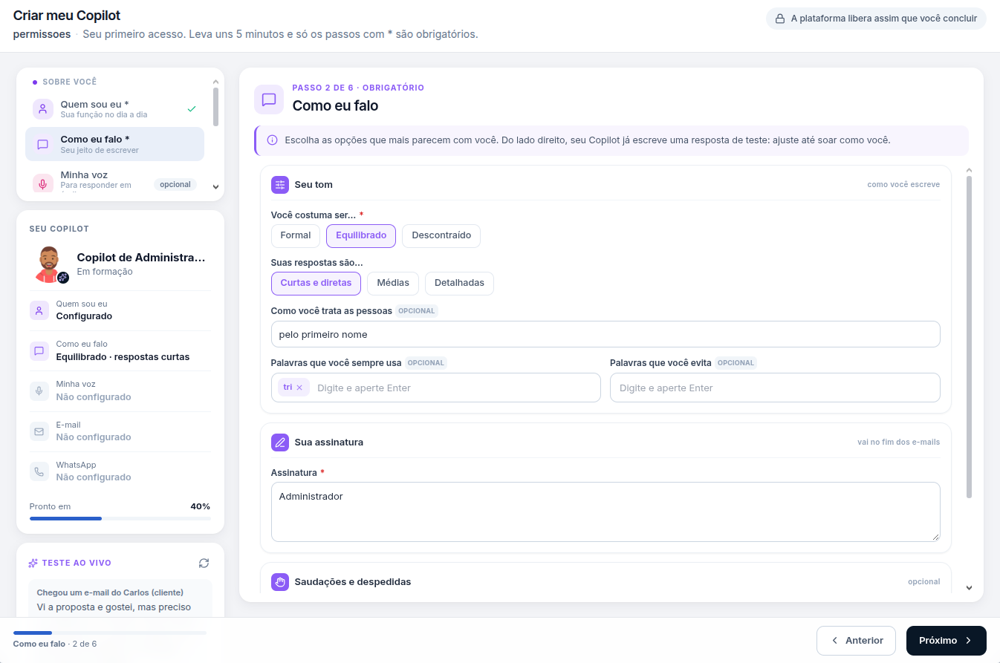
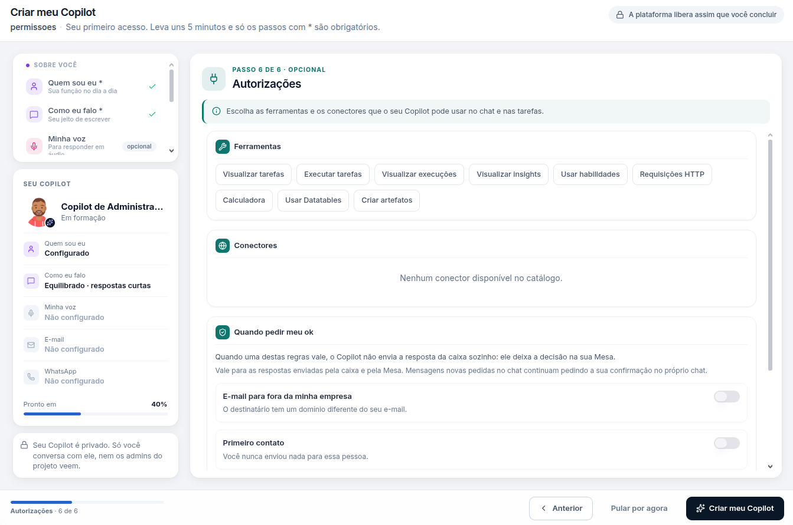
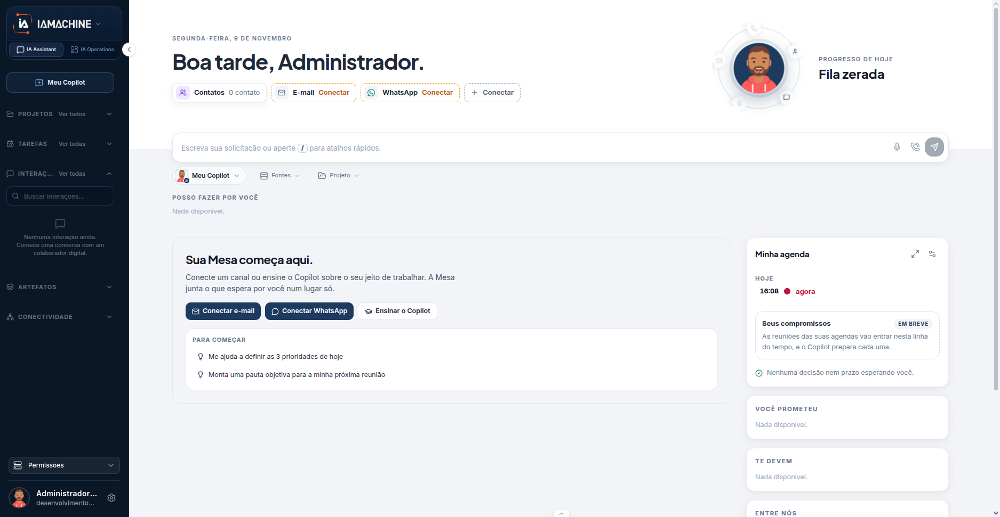

# Primeiro acesso

Entrar na conta não libera o chat deste projeto. Primeiro o projeto fica selecionado. Depois o Meu Copilot existe. Este percurso cria um Copilot do zero e para nos dois passos obrigatórios. Voz, e-mail e WhatsApp podem ficar para depois.

O Meu Copilot é privado. A tela repete isso: só você conversa com ele, nem os administradores do projeto veem essa conversa.


Quem já tem Copilot em outro projeto vê, antes dos passos, a escolha entre trazer o existente e começar do zero. Este percurso segue **Começar do zero**.




## Escolha o projeto

No menu lateral, abra o seletor. O projeto marcado com o visto é o que vale para o Copilot, as tarefas e a Torre. Neste percurso o visto está em **Permissões**. A mesma lista tem **+ Adicionar Projeto**.

O nome **Permissões** volta no bloco de baixo, acima do seu usuário. Confira esse nome antes de continuar. Trocar de projeto no meio do assistente troca o Copilot que você está criando.



## Comece do zero

No primeiro acesso ao projeto, a plataforma abre **Criar meu Copilot**. O texto do topo diz: leva uns 5 minutos e só os passos com \* são obrigatórios. A plataforma libera o uso assim que você conclui.

O título usa o projeto e o seu nome. Neste exemplo: **Boas-vindas ao permissões, Administrador.**

Há dois cartões:

| Cartão                              | O que faz                                                                                                                                         |
| ----------------------------------- | ------------------------------------------------------------------------------------------------------------------------------------------------- |
| Trazer meu Copilot de outro projeto | Copia quem você é, o jeito de falar e a voz. O rádio **De qual projeto?** lista os projetos que já têm Copilot. O botão é **Trazer em 1 minuto**. |
| Criar um Copilot do zero            | Abre os seis passos só para este projeto. A marca é **5 minutos**. O botão é **Começar do zero**.                                                 |

Clique em **Começar do zero**.

O rodapé desta tela avisa: privado, só você conversa com seu Copilot, e dá para mudar tudo depois em **Perfil › Meu Copilot**.



## Quem sou eu

É o passo 1 de 6, obrigatório. A pergunta que fecha o passo é **O que você faz no trabalho?**. Nome e cargo não aparecem neste formulário.

A tela traz o que já estava no cadastro para conferir. Dá para escrever ou usar **Falar em vez de escrever**, que grava um áudio curto e transforma em texto.

Três blocos podem ficar vazios neste primeiro acesso:

* **Seus e-mails ainda não foram lidos.** Conectar o e-mail preenche com a Leitura inicial. Também dá para acrescentar à mão.
* **Com quem trabalho.** Nenhuma pessoa ainda. **+ Acrescentar pessoa** inclui alguém e o tratamento.
* **Meus assuntos.** Nenhum assunto ainda.

Com o campo obrigatório preenchido, o cartão **Seu Copilot** marca **Quem sou eu** como **Configurado** e a barra fica em **Pronto em 20%**. O Copilot aparece como **Em formação**. Clique em **Próximo**.



## Como eu falo

É o passo 2 de 6, obrigatório. As escolhas definem o tom das respostas e a assinatura que vai no fim dos e-mails.

| Campo                        | Neste exemplo                                            |
| ---------------------------- | -------------------------------------------------------- |
| Você costuma ser…            | Equilibrado. As outras opções são Formal e Descontraído. |
| Suas respostas são…          | Curtas e diretas. As outras são Médias e Detalhadas.     |
| Como você trata as pessoas   | Opcional. Aqui, "pelo primeiro nome".                    |
| Palavras que você sempre usa | Opcional.                                                |
| Palavras que você evita      | Opcional.                                                |
| Assinatura                   | Obrigatória. Vai no fim dos e-mails.                     |

O bloco **Teste ao vivo**, no canto esquerdo, mostra uma resposta de exemplo enquanto você ajusta. Saudações e despedidas ficam recolhidas e são opcionais.

O cartão passa a mostrar o resumo, neste exemplo **Equilibrado · respostas curtas**, e a barra vai a **Pronto em 40%**. **Quem sou eu** ganha o visto no menu. Clique em **Próximo**.



## Passe pelos passos opcionais

Minha voz, E-mail e WhatsApp são os passos 3, 4 e 5. Nenhum deles impede o chat em texto. Neste percurso os três ficam **Não configurado**.

Siga até o passo 6. A barra continua em **40%**: passo pulado não entra em **Pronto em** e não ganha visto.



## Autorize e crie

**Autorizações** é o passo 6 de 6, opcional. O texto pede as ferramentas e os conectores que este Copilot pode usar no chat e nas tarefas. Autorizar aqui não cadastra a ferramenta no projeto. O catálogo do projeto continua em **Conectores**, na aba **IA Operations**.

O bloco **Ferramentas** lista Visualizar tarefas, Executar tarefas, Visualizar execuções, Visualizar insights, Usar habilidades, Requisições HTTP, Calculadora, Usar Datatables e Criar artefatos.

**Conectores** pode aparecer vazio: **Nenhum conector disponível no catálogo.**

**Quando pedir meu ok** segura o envio pela caixa e pela Mesa quando a regra vale. Os dois interruptores começam desligados:

* **E-mail para fora da minha empresa.** O destinatário tem um domínio diferente do seu e-mail.
* **Primeiro contato.** Você nunca enviou nada para essa pessoa.

Mensagem nova pedida no chat continua pedindo confirmação no próprio chat, com ou sem esses interruptores.

Os dois passos obrigatórios já estão com visto. O botão **Criar meu Copilot** fica liberado. **Pular por agora** também está no rodapé. Clique em **Criar meu Copilot**.



## O chat abre no Meu Copilot

A aba **IA Assistant** abre o chat. A aba ao lado, **IA Operations**, é a operação do projeto. O menu lateral continua em **Permissões**.

O que confere se o primeiro acesso terminou:

* A saudação usa o seu nome. O destinatário já é **Meu Copilot**.
* O campo pede: **Escreva sua solicitação ou aperte / para atalhos rápidos.**
* **E-mail** e **WhatsApp** aparecem como **Conectar**. O chat em texto não espera esses canais.
* **Progresso de hoje** mostra **Fila zerada**.
* **Sua Mesa começa aqui** oferece **Conectar e-mail**, **Conectar WhatsApp** e **Ensinar o Copilot**.
* **Para começar** traz pedidos prontos. Um deles entra no campo quando você clica.

Em **Interações**, a lista vazia diz: **Nenhuma interação ainda. Comece uma conversa com um colaborador digital.** A primeira mensagem deste percurso sai no **Meu Copilot**, que já está escolhido no campo.

**Minha agenda** e os blocos **Você prometeu** e **Te devem** podem ficar vazios. **Em breve**, em compromissos, é um recurso que ainda não está nesta tela.



## Limite deste percurso

Sem projeto selecionado, o assistente não abre. A voz, o e-mail e o WhatsApp continuam **Não configurado** até alguém voltar em **Perfil › Meu Copilot**. Conectar um canal não faz o Copilot enviar sozinho.

## Dúvidas comuns

Criei o Copilot e ele não aparece em Colaboradores digitais. Esta lista, em **IA Operations**, é a dos agentes da operação. O Meu Copilot fica no **IA Assistant** e a conversa é só sua.

A barra parou em 40%. Os passos 3, 4 e 5 ficaram sem configurar. O chat já funciona. Completar voz, e-mail ou WhatsApp aumenta o **Pronto em** quando o passo é salvo.

O envio do chat não sai. Confira o destinatário. Neste percurso ele já vem em **Meu Copilot**. Sem destinatário, não há para quem enviar.

Autorizei uma ferramenta e o conector não surgiu no projeto. Autorizações vale para este Copilot. Cadastrar a ferramenta para o projeto é a tela **Conectores**, e pede administrador.
