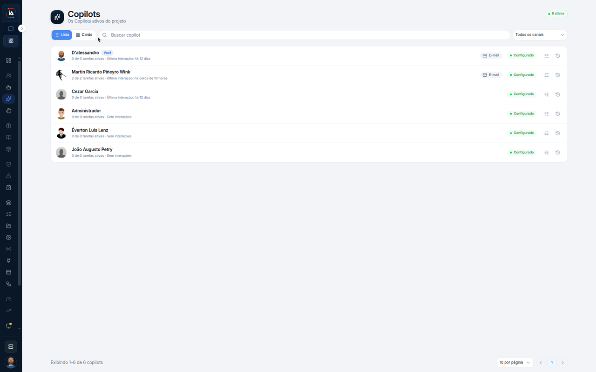

# Copilots do projeto

**Copilots** é a lista dos Copilots ativos do projeto. Não é a caixa do **Meu Copilot** na aba **IA Assistant**. Este percurso só lê a lista.



## Abra Copilots

Na aba **IA Operations**, em **Força de trabalho**, clique em **Copilots**.

O título é **Copilots**. O texto debaixo é **Os Copilots ativos do projeto**. O canto marca **6 ativos**. A vista marcada é **Lista**. Ao lado está **Cards**. A busca diz **Buscar copilot**. O filtro está em **Todos os canais**.

| Nome | Tarefas e interação | Canal | Estado |
| --- | --- | --- | --- |
| **D'alessandro**, com a marca **Você** | **0 de 0 tarefas ativas**. **Última interação: há 12 dias** | **E-mail** | **Configurado** |
| **Martin Ricardo Piñeyro Wink** | **2 de 2 tarefas ativas**. **Última interação: há cerca de 18 horas** | **E-mail** | **Configurado** |
| **Cezar Garcia** | **0 de 0 tarefas ativas**. **Última interação: há 12 dias** |  | **Configurado** |
| **Administrador** | **0 de 0 tarefas ativas**. **Sem interações** |  | **Configurado** |
| **Éverton Luis Lenz** | **0 de 0 tarefas ativas**. **Sem interações** |  | **Configurado** |
| **João Augusto Petry** | **0 de 0 tarefas ativas**. **Sem interações** |  | **Configurado** |

O rodapé diz **Exibindo 1-6 de 6 copilots** e **10 por página**. A página **1** está aberta. Cada linha tem um ícone de menu. Este percurso não clica nele.



## Limite deste percurso

**Lista** é a vista deste print. **Cards** aparece e não é aberto. A busca e o filtro **Todos os canais** ficam como estão. O menu da linha não é aberto.

## Dúvidas comuns

O texto da página é **Os Copilots ativos do projeto**, e o canto marca **6 ativos**. A linha **D'alessandro** traz a marca **Você**. A caixa do dia a dia continua no **Meu Copilot**, na aba **IA Assistant**.

As duas primeiras linhas mostram **E-mail** e **Configurado**. As outras quatro mostram **Configurado**, sem o chip **E-mail**.

<table data-view="cards"><thead><tr><th>Página</th><th data-card-target data-type="content-ref">Abrir</th></tr></thead><tbody><tr><td><strong>Copilots</strong> Lista os Copilots do projeto. É o Copilot operacional do projeto, diferente do Meu Copilot.</td><td><a href="https://ia-machine.gitbook.io/ia-machine-docs/operations/forca-de-trabalho/copilots">https://ia-machine.gitbook.io/ia-machine-docs/operations/forca-de-trabalho/copilots</a></td></tr></tbody></table>
