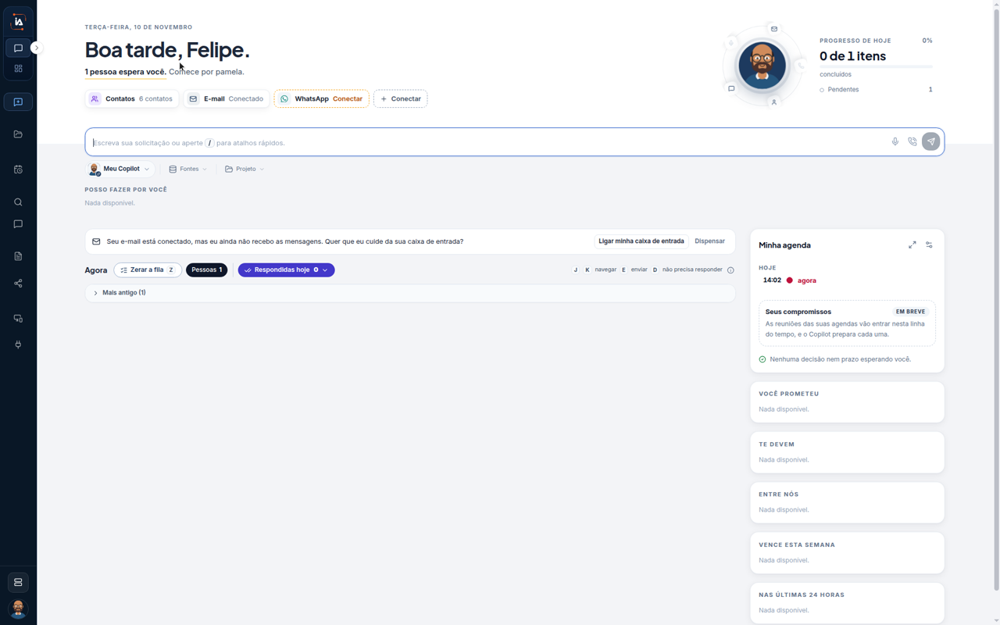

# O dia no Meu Copilot

A aba **IA Assistant** abre a caixa do **Meu Copilot**. Este percurso lê a caixa que já está em uso. Não envia mensagem e não clica em **Conectar**.

O [Primeiro acesso](comecar/primeiro-acesso.md) abre a mesma caixa num outro momento, antes de chegar gente. Nesta tela a saudação já diz que alguém espera você.



## Abra a caixa

Na aba **IA Assistant**, abra o **Meu Copilot**.

O alto deste print:

| O que aparece | Neste print |
| --- | --- |
| Data | **TERÇA-FEIRA, 10 DE NOVEMBRO** |
| Saudação | **Boa tarde, Felipe.** |
| Quem espera | **1 pessoa espera você. Comece por pamela.** |
| Contatos | **Contatos** **6 contatos** |
| E-mail | **E-mail** **Conectado** |
| WhatsApp | **WhatsApp** **Conectar** |
| Outro canal | **+ Conectar** |
| Progresso | **PROGRESSO DE HOJE** **0%**, **0 de 1 itens**, **concluídos**, **Pendentes** **1** |

O campo diz **Escreva sua solicitação ou aperte / para atalhos rápidos.** Abaixo ficam **Meu Copilot**, **Fontes** e **Projeto**. **POSSO FAZER POR VOCÊ** diz **Nada disponível.**

Uma faixa avisa: **Seu e-mail está conectado, mas eu ainda não recebo as mensagens. Quer que eu cuide da sua caixa de entrada?** Os botões dessa faixa são **Ligar minha caixa de entrada** e **Dispensar**. Este percurso não clica neles.

A lista **Agora** marca **Zerar a fila** **2**, **Pessoas** **1** e **Respondidas hoje** **0**. Abaixo, **Mais antigo (1)**. Os atalhos visíveis são **J** **K** **navegar**, **E** **enviar** e **D** **não precisa responder**. Este percurso não usa esses atalhos.

O painel **Minha agenda** marca **HOJE** e **14:02** **agora**.

| Bloco | Neste print |
| --- | --- |
| **Seus compromissos** | **EM BREVE**. O texto diz que as reuniões das agendas vão entrar nesta linha e que o Copilot prepara cada uma. Depois: **Nenhuma decisão nem prazo esperando você.** |
| **VOCÊ PROMETEU** | **Nada disponível.** |
| **TE DEVEM** | **Nada disponível.** |
| **ENTRE NÓS** | **Nada disponível.** |
| **VENCE ESTA SEMANA** | **Nada disponível.** |
| **NAS ÚLTIMAS 24 HORAS** | **Nada disponível.** |



## Limite deste percurso

**WhatsApp** está em **Conectar** e **+ Conectar** também aparece. Nenhum dos dois é aberto aqui. A faixa do e-mail oferece **Ligar minha caixa de entrada** e **Dispensar**. Os dois ficam sem clique. O campo de texto fica vazio.

## Dúvidas comuns

A saudação e a linha **1 pessoa espera você. Comece por pamela.** mostram a caixa com gente. **Zerar a fila** está em **2** e **Pessoas** está em **1**.

**E-mail** está **Conectado**, e a faixa em seguida diz que o Copilot ainda não recebe as mensagens. **PROGRESSO DE HOJE** está em **0%**, com **0 de 1 itens** e **Pendentes** **1**.

<table data-view="cards"><thead><tr><th>Página</th><th data-card-target data-type="content-ref">Abrir</th></tr></thead><tbody><tr><td><strong>Meu Copilot no chat</strong> O Chat é a tela em que o pedido vira conversa.</td><td><a href="https://ia-machine.gitbook.io/ia-machine-docs/assistant/ia-assistant/chat">https://ia-machine.gitbook.io/ia-machine-docs/assistant/ia-assistant/chat</a></td></tr></tbody></table>
