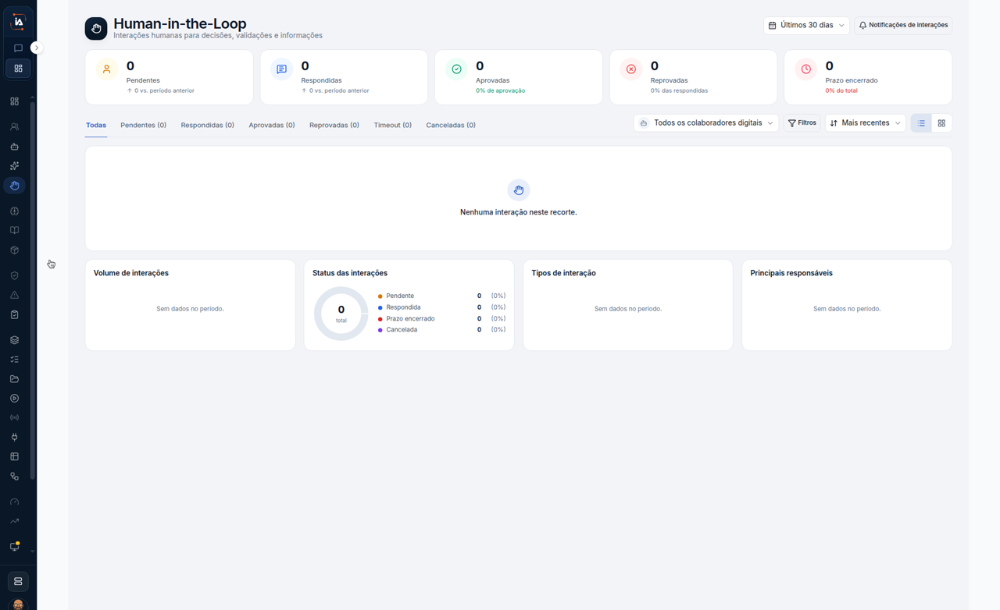

# Interações humanas

**Interações humanas** é a fila do que espera uma pessoa. Este percurso só lê a tela. Neste print a fila do recorte está vazia.



## Abra Interações humanas

Na aba **IA Operations**, em **Força de trabalho**, clique em **Interações humanas**.

O título é **Human-in-the-Loop**. O texto debaixo é **Interações humanas para decisões, validações e informações.** O período marcado é **Últimos 30 dias**. Ao lado está **Notificações de interações**.

Os contadores deste print:

| Contador | Neste print |
| --- | --- |
| **Pendentes** | **0**, **0 vs. período anterior** |
| **Respondidas** | **0**, **0 vs. período anterior** |
| **Aprovadas** | **0**, **0% de aprovação** |
| **Reprovadas** | **0**, **0% das respondidas** |
| **Prazo encerrado** | **0**, **0% do total** |

As abas são **Todas**, **Pendentes (0)**, **Respondidas (0)**, **Aprovadas (0)**, **Reprovadas (0)**, **Timeout (0)** e **Canceladas (0)**. **Todas** é a aba marcada.

O filtro de pessoas está em **Todos os colaboradores digitais**. Ao lado ficam **Filtros** e **Mais recentes**. O centro da lista diz **Nenhuma interação neste recorte.**

Os quatro blocos de baixo:

| Bloco | Neste print |
| --- | --- |
| **Volume de interações** | **Sem dados no período.** |
| **Status das interações** | **0** **total**. **Pendente** **0 (0%)**, **Respondida** **0 (0%)**, **Prazo encerrado** **0 (0%)**, **Cancelada** **0 (0%)** |
| **Tipos de interação** | **Sem dados no período.** |
| **Principais responsáveis** | **Sem dados no período.** |



## Limite deste percurso

O período marcado é **Últimos 30 dias**. **Notificações de interações** aparece e não é aberto. As abas estão todas em zero. Este passo a passo não troca a aba nem o filtro.

## Dúvidas comuns

Os cinco contadores estão em **0**. A frase do meio é **Nenhuma interação neste recorte.** **Volume de interações**, **Tipos de interação** e **Principais responsáveis** dizem **Sem dados no período.**

<table data-view="cards"><thead><tr><th>Página</th><th data-card-target data-type="content-ref">Abrir</th></tr></thead><tbody><tr><td><strong>Interações humanas</strong> Fila do que o fluxo parou para uma pessoa decidir ou responder.</td><td><a href="https://ia-machine.gitbook.io/ia-machine-docs/operations/forca-de-trabalho/interacoes-humanas">https://ia-machine.gitbook.io/ia-machine-docs/operations/forca-de-trabalho/interacoes-humanas</a></td></tr></tbody></table>
