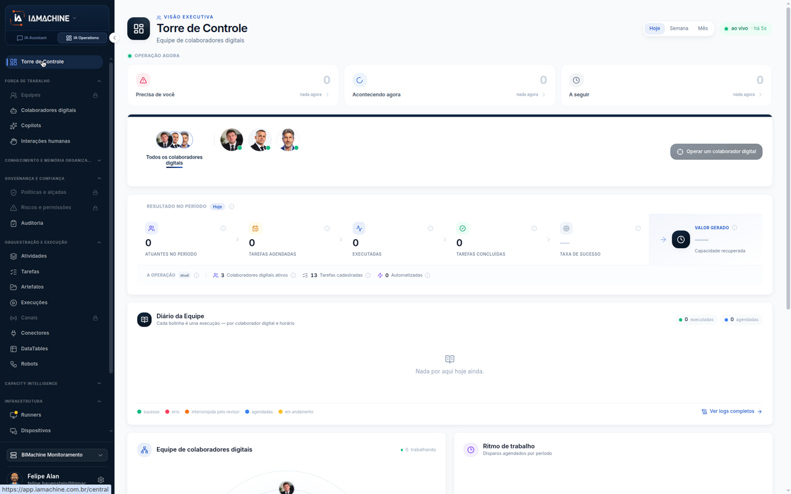
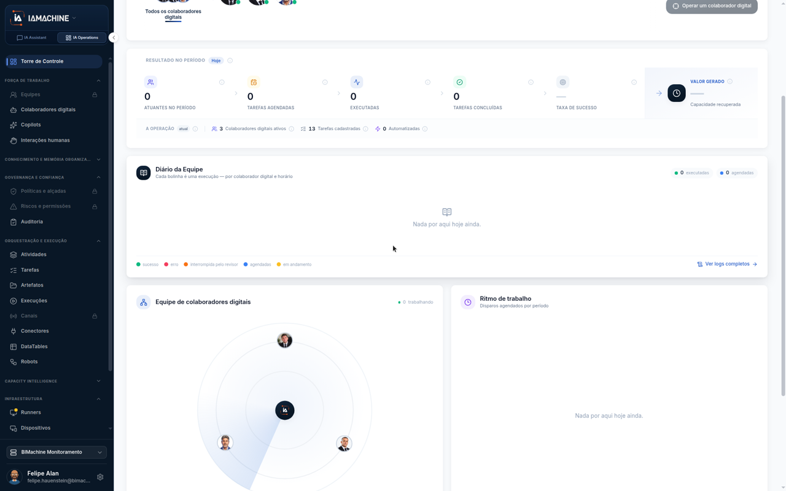
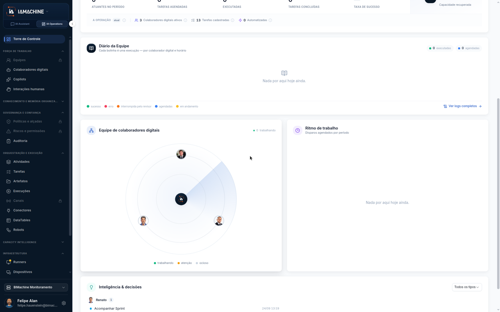
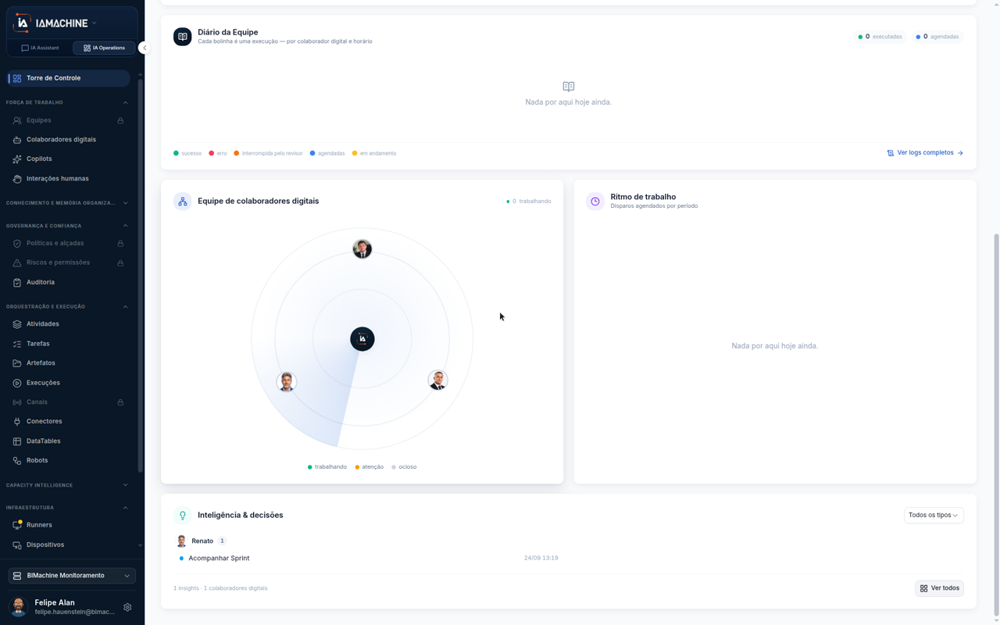

# Ler a Torre hoje

A **Torre de Controle** mostra, em tempo real, o que sua equipe de colaboradores digitais está fazendo e o resultado da operação no período selecionado.

## Passo a passo




### Abrir a Torre

1. Clique na aba **IA Operations** no topo da tela
2. No menu lateral, clique em **Torre de Controle**

A página carrega mostrando dados de **Hoje** por padrão.

<figure><figcaption>O bloco mostra o que está acontecendo neste momento</figcaption></figure>



### Ler o bloco "Operação agora"

Este bloco mostra quantas tarefas:

* **Precisa de você**: aguardam intervenção humana
* **Acontecendo agora**: estão sendo executadas
* **A seguir**: estão na fila para rodar

Quando todos os contadores estão em zero, não há operação em andamento no momento.



### Ver os resultados do período

O bloco **Resultado no período** resume o que já aconteceu hoje:

* **Atuantes no período**: quantos colaboradores digitais trabalharam
* **Tarefas agendadas**: quantas tarefas estavam programadas
* **Executadas**: quantas rodaram de fato
* **Tarefas concluídas**: quantas terminaram com sucesso
* **Taxa de sucesso**: percentual de conclusão
* **Valor gerado**: estimativa de economia

<figure><figcaption>Resumo do que já aconteceu hoje</figcaption></figure>



### Consultar o Diário da Equipe

Mais abaixo, o **Diário da Equipe** lista eventos importantes que ocorreram, como:

* Tarefas concluídas
* Erros ou alertas
* Intervenções humanas

Quando não há eventos, aparece "Nada por aqui hoje ainda".

A visualização circular mostra a equipe de colaboradores ativos, com ícones e status de cada um.

<figure><figcaption>Linha do tempo de eventos e visualização da equipe</figcaption></figure>



### Ver Inteligência & decisões

O último bloco, **Inteligência & decisões**, apresenta insights gerados pela IA Machine com base nos dados coletados:

* Sugestões de otimização
* Padrões identificados
* Recomendações de ação

Cada insight mostra quem publicou, quantos colaboradores estão envolvidos, e a data da análise.

<figure><figcaption>Insights e recomendações baseados em dados</figcaption></figure>




## Navegação por período

No topo da Torre, você pode trocar o período exibido:

* **Hoje**: operação em tempo real
* **Ontem**: resumo do dia anterior
* **Últimos 7 dias / 30 dias**: visão histórica

Cada período atualiza todos os blocos com os dados correspondentes.
