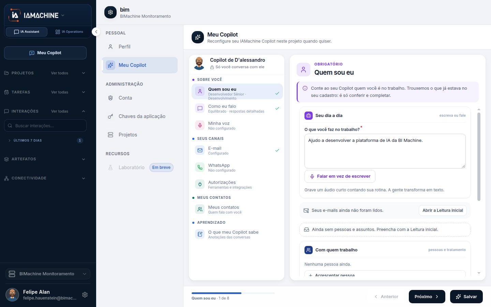

# Meu Copilot

O Meu Copilot é o agente pessoal deste projeto. Ele aprende como você trabalha para responder no chat no seu tom, e só envia e-mail ou WhatsApp quando você pede. Administrador do projeto não lê essa conversa. Ter um colaborador digital na operação não substitui este cadastro, e este cadastro não cria um colaborador para a equipe.

O percurso ilustrado, do seletor do projeto até o chat, está em Primeiro acesso. Esta página é a referência dos mesmos nomes.


[primeiro-acesso.md](comecar/primeiro-acesso.md)


## Para que serve

Configura o Copilot da pessoa neste projeto. O texto do topo diz: leva uns 5 minutos e só os passos com \* são obrigatórios. A plataforma libera o uso assim que você conclui.

## Quem vê

Só essa pessoa. O Copilot é privado. A tela repete: só você conversa com ele, nem os administradores do projeto veem essa conversa.

## Onde fica

Configurações, aba Pessoal, Meu Copilot. No primeiro acesso a um projeto, a plataforma abre **Criar meu Copilot**. Dá para reabrir depois em **Perfil › Meu Copilot**.

## O que a tela mostra

**Meu Copilot** está no passo **Quem sou eu**. O cartão diz **Copilot de D'alessandro** e **Só você conversa com ele**. **E-mail** está **Configurado**. **WhatsApp** e **Minha voz** estão **Não configurado**.

Os passos são Quem sou eu, Como eu falo, Minha voz, E-mail, WhatsApp e Autorizações. Quem sou eu e Como eu falo são obrigatórios. Os outros três podem ficar **Não configurado**.


Se ainda não houver projeto, a tela avisa: "Nenhum projeto selecionado. Escolha um projeto para criar seu Copilot."


Se a pessoa já tem Copilot em outro projeto, a abertura oferece dois cartões. **Trazer meu Copilot de outro projeto** copia quem você é, o jeito de falar e a voz. O rádio **De qual projeto?** lista os projetos que já têm Copilot. O botão é **Trazer em 1 minuto**. **Criar um Copilot do zero** abre os seis passos só para este projeto. A marca é **5 minutos**. O botão é **Começar do zero**. O título desta abertura usa o projeto e o nome. Num exemplo da tela: **Boas-vindas ao permissões, Administrador.**

Os botões do rodapé são **Anterior**, **Próximo** e, nos passos opcionais, **Pular por agora**. Passo pulado não entra em **Pronto em** e não ganha visto. Com só os dois obrigatórios, a barra fica em **40%**.

O cartão **Seu Copilot** mostra o que já foi salvo. No passo 1, com o campo obrigatório preenchido, **Quem sou eu** fica **Configurado** e a barra marca **Pronto em 20%**. O Copilot aparece como **Em formação**. No passo 2, **Quem sou eu** ganha o visto e a barra vai a **Pronto em 40%**.

## Campos

**Quem sou eu.** Passo 1 de 6, obrigatório. A pergunta que fecha o passo é **O que você faz no trabalho?**. Dá para escrever ou usar **Falar em vez de escrever**, que grava um áudio curto e transforma em texto. Nome, cargo, área e telefone não estão neste formulário.

Três blocos podem ficar vazios neste primeiro acesso:

* **Seus e-mails ainda não foram lidos.** Conectar o e-mail preenche com a Leitura inicial. Também dá para acrescentar à mão.
* **Com quem trabalho.** Nenhuma pessoa ainda. **+ Acrescentar pessoa** inclui alguém e o tratamento.
* **Meus assuntos.** Nenhum assunto ainda.

**Como eu falo.** Passo 2 de 6, obrigatório. Define o tom das respostas e a assinatura que vai no fim dos e-mails.

| Campo                        | Opções                                 |
| ---------------------------- | -------------------------------------- |
| Você costuma ser…            | Formal, Equilibrado ou Descontraído    |
| Suas respostas são…          | Curtas e diretas, Médias ou Detalhadas |
| Como você trata as pessoas   | Opcional                               |
| Palavras que você sempre usa | Opcional                               |
| Palavras que você evita      | Opcional                               |
| Assinatura                   | Obrigatória. Vai no fim dos e-mails    |

Saudações e despedidas ficam recolhidas e são opcionais. O **Teste ao vivo** fica no canto esquerdo e mostra uma resposta de exemplo enquanto você ajusta. O cartão resume a escolha, por exemplo **Equilibrado · respostas curtas**.

**Minha voz, E-mail e WhatsApp.** Passos 3, 4 e 5, opcionais. Nenhum deles impede o chat em texto. O passo a passo de cada um não entra nesta página.

**Autorizações.** Passo 6 de 6, opcional. O texto pede as ferramentas e os conectores que este Copilot pode usar no chat e nas tarefas. Autorizar aqui não cadastra a ferramenta no projeto.

O bloco **Ferramentas** lista Visualizar tarefas, Executar tarefas, Visualizar execuções, Visualizar insights, Usar habilidades, Requisições HTTP, Calculadora, Usar Datatables e Criar artefatos.

**Conectores** pode aparecer vazio: **Nenhum conector disponível no catálogo.**

**Quando pedir meu ok** segura o envio pela caixa e pela Mesa quando a regra vale. Os dois interruptores começam desligados:

* **E-mail para fora da minha empresa.** O destinatário tem um domínio diferente do seu e-mail.
* **Primeiro contato.** Você nunca enviou nada para essa pessoa.

Mensagem nova pedida no chat continua pedindo confirmação no próprio chat, com ou sem esses interruptores.

Com os dois passos obrigatórios marcados, o botão **Criar meu Copilot** fica liberado. **Pular por agora** também está no rodapé.

## O que dá para fazer

Concluir os dois passos obrigatórios, pular voz, e-mail e WhatsApp, e trazer um Copilot de outro projeto. Depois dá para voltar em **Perfil › Meu Copilot** e completar o que ficou **Não configurado**.

<table data-view="cards"><thead><tr><th>Passo</th><th data-card-target data-type="content-ref">Abrir</th></tr></thead><tbody><tr><td><strong>E-mail</strong> O e-mail do Copilot lê a sua caixa e envia em seu nome só quando você pede no chat.</td><td><a href="https://ia-machine.gitbook.io/ia-machine-docs/assistant/ia-assistant/email">https://ia-machine.gitbook.io/ia-machine-docs/assistant/ia-assistant/email</a></td></tr><tr><td><strong>WhatsApp</strong> O WhatsApp do Copilot envia mensagens pelo seu número quando você pede no chat.</td><td><a href="https://ia-machine.gitbook.io/ia-machine-docs/assistant/ia-assistant/whatsapp">https://ia-machine.gitbook.io/ia-machine-docs/assistant/ia-assistant/whatsapp</a></td></tr><tr><td><strong>Minha voz</strong> A voz do Copilot serve para respostas em áudio e para a Voz ao Vivo.</td><td><a href="https://ia-machine.gitbook.io/ia-machine-docs/assistant/ia-assistant/voz">https://ia-machine.gitbook.io/ia-machine-docs/assistant/ia-assistant/voz</a></td></tr><tr><td><strong>Chat</strong> A saudação usa o seu nome. O destinatário já é Meu Copilot.</td><td><a href="https://ia-machine.gitbook.io/ia-machine-docs/assistant/ia-assistant/chat">https://ia-machine.gitbook.io/ia-machine-docs/assistant/ia-assistant/chat</a></td></tr></tbody></table>

## Limite atual

Passo pulado não aumenta **Pronto em** e não ganha visto. A voz clonada, quando existe, se apaga na tela de voz ao trocar por uma voz do catálogo. O botão de confirmação é **Trocar e apagar a clonada**.


Trocar uma voz clonada por uma voz do catálogo apaga a voz clonada e revoga a autorização.


## Dúvidas comuns

**Preciso conectar e-mail e WhatsApp para usar o chat?** Não. Só Quem sou eu e Como eu falo são obrigatórios. Os canais podem ficar **Não configurado**. A barra permanece em **40%** até esses passos serem salvos.

**Autorizar uma ferramenta aqui cria o conector da empresa?** Não. Autorizações vale para este Copilot. O catálogo pode dizer **Nenhum conector disponível no catálogo.** Cadastrar a ferramenta para o projeto é a tela Conectores, e pede administrador.

**O nome e o cargo entram em Quem sou eu?** Não. Esse formulário pede **O que você faz no trabalho?**. Nome, cargo, área e telefone não estão nele.

**O que o teste ao vivo mostra?** Uma resposta de exemplo, no canto esquerdo, enquanto você ajusta o tom e o tamanho.
