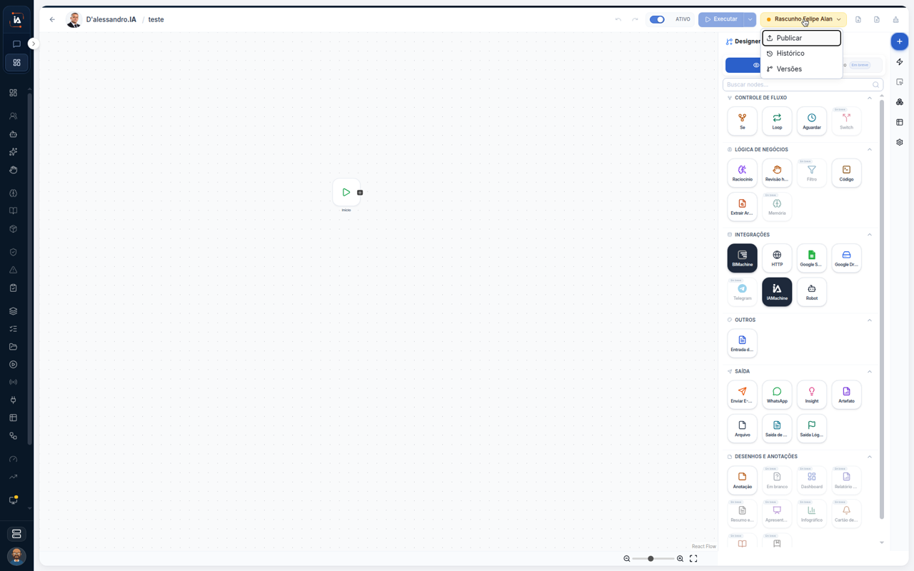

# Publicar o fluxo

Publicar troca a versão que a operação passa a usar. Este percurso só abre o menu de um fluxo que ainda está em rascunho. Não confirma **Publicar** e não clica em **Executar**.



## Abra o menu do rascunho

Na aba **IA Operations**, abra o fluxo de uma tarefa cujo controle diga **Rascunho**. Neste print o cabeçalho é **D'alessandro.IA / teste**.

O controle amarelo diz **Rascunho Felipe Alan**. O menu aberto lista, nesta ordem:

| Item do menu | Neste print |
| --- | --- |
| **Publicar** | Primeira linha. Não foi confirmado. |
| **Histórico** | Segunda linha. |
| **Versões** | Terceira linha. |

Ao lado do controle, o interruptor **ATIVO** está ligado e o botão **Executar** aparece. Os dois ficam como estão.

A tela do fluxo mostra o nó **Início**. O painel da direita é o **Designer**, com **Buscar nodes...** e o grupo **CONTROLE DE FLUXO**. Vários nós desse painel estão com o nome cortado ou com a marca **Em breve**. Este percurso não arrasta nó.



## Limite deste percurso

O menu fica aberto só para leitura. **Publicar** não é confirmado, então o controle continua **Rascunho Felipe Alan**. **Executar** não é clicado. O interruptor **ATIVO** não é mexido. Nó com a marca **Em breve** não entra no passo a passo.

## Dúvidas comuns

O cabeçalho deste print é **D'alessandro.IA / teste**. O controle amarelo diz **Rascunho Felipe Alan**, e o menu mostra **Publicar**, **Histórico** e **Versões**. A tela do fluxo já tem o nó **Início**.

<table data-view="cards"><thead><tr><th>Página</th><th data-card-target data-type="content-ref">Abrir</th></tr></thead><tbody><tr><td><strong>Editor de fluxo</strong> Publicar gera a versão que passa a valer.</td><td><a href="https://ia-machine.gitbook.io/ia-machine-docs/operations/orquestracao/tarefas/fluxo">https://ia-machine.gitbook.io/ia-machine-docs/operations/orquestracao/tarefas/fluxo</a></td></tr></tbody></table>
