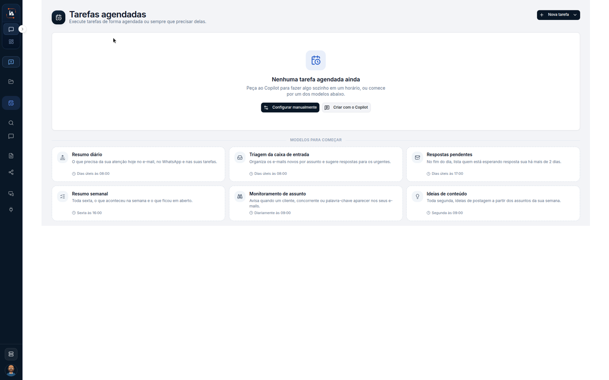

# Tarefas do Copilot

**Tarefas agendadas** é a agenda da pessoa com o próprio Copilot. Não é a tarefa de um colaborador digital. Este percurso lê a agenda vazia e os modelos que a tela mostra. Não cria tarefa.



## Abra Tarefas agendadas

Na aba **IA Assistant**, abra **Tarefas agendadas**.

O título é **Tarefas agendadas**. O texto debaixo é **Execute tarefas de forma agendada ou sempre que precisar delas.** O botão do canto é **+ Nova tarefa**.

O centro diz **Nenhuma tarefa agendada ainda**. A frase seguinte é **Peça ao Copilot para fazer algo sozinho em um horário, ou comece por um dos modelos abaixo.** Os botões são **Configurar manualmente** e **Criar com o Copilot**.

A faixa **MODELOS PARA COMEÇAR** traz seis cards:

| Modelo | Texto | Horário |
| --- | --- | --- |
| **Resumo diário** | O que precisa da sua atenção hoje no e-mail, no WhatsApp e nas suas tarefas. | **Dias úteis às 08:00** |
| **Triagem da caixa de entrada** | Organiza os e-mails novos por assunto e sugere respostas para os urgentes. | **Dias úteis às 08:00** |
| **Respostas pendentes** | No fim do dia, lista quem está esperando resposta sua há mais de 2 dias. | **Dias úteis às 17:00** |
| **Resumo semanal** | Toda sexta, o que aconteceu na semana e o que ficou em aberto. | **Sexta às 16:00** |
| **Monitoramento de assunto** | Avisa quando um cliente, concorrente ou palavra-chave aparecer nos seus e-mails. | **Diariamente às 09:00** |
| **Ideias de conteúdo** | Toda segunda, ideias de postagem a partir dos assuntos da sua semana. | **Segunda às 09:00** |



## Limite deste percurso

**+ Nova tarefa**, **Configurar manualmente**, **Criar com o Copilot** e os cards de modelo aparecem na tela. Nenhum deles é clicado. A agenda continua em **Nenhuma tarefa agendada ainda**.

## Dúvidas comuns

A página não pede para selecionar um projeto. Ela abre direto na agenda e mostra a frase **Nenhuma tarefa agendada ainda**, com a faixa **MODELOS PARA COMEÇAR** embaixo.

<table data-view="cards"><thead><tr><th>Página</th><th data-card-target data-type="content-ref">Abrir</th></tr></thead><tbody><tr><td><strong>Tarefas do Copilot</strong> Tarefas que o Copilot da pessoa dispara.</td><td><a href="https://ia-machine.gitbook.io/ia-machine-docs/assistant/ia-assistant/tarefas">https://ia-machine.gitbook.io/ia-machine-docs/assistant/ia-assistant/tarefas</a></td></tr></tbody></table>
