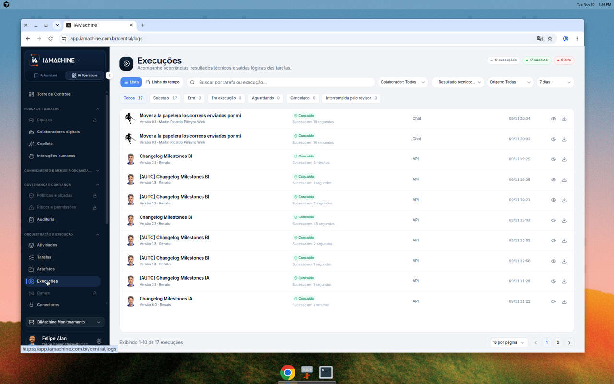

# Ver o histórico de execuções

**Execuções** fica em **Orquestração e execução**, na aba **IA Operations**. O texto da página diz: **Acompanhe ocorrências, resultados técnicos e saídas lógicas das tarefas.** Este percurso só lê a lista. Não abre uma linha e não baixa arquivo.



## Abra Execuções

No menu lateral, em **Orquestração e execução**, clique em **Execuções**.

Neste print o canto direito marca **17 execuções**, **17 sucesso** e **0 erro**.



## Leia uma linha

Cada linha traz o nome da tarefa, a versão, o colaborador, o estado, o canal e a data.

Neste print a primeira linha é **Mover a papelera los correos enviados por mí**, **Versão 0.1**, colaborador **Martin Ricardo Piñeyro Wibe**. O estado é **Concluído**, com **Sucesso em 18 segundos**. O canal é **Chat**. A data é **08/11 20:04**. Outras linhas deste print usam o canal **API** e também estão **Concluído**.

O fim de cada linha tem dois ícones. Este percurso não clica neles.



## Use o que a barra mostra

Acima da lista, **Lista** está marcado. **Linha do tempo** fica ao lado. A busca pede **Buscar por tarefa ou execução...**

Os filtros visíveis neste print:

| Filtro | Neste print |
| --- | --- |
| Colaborador | Todos |
| Resultado técnico | O nome começa assim e o restante fica cortado na tela. |
| Origem | Todas |
| Período | 7 dias |

As abas contam o estado. Neste print:

| Aba | Contagem |
| --- | --- |
| Todos | 17 |
| Sucesso | 17 |
| Erro | 0 |
| Em execução | 0 |
| Aguardando | 0 |
| Cancelado | 0 |
| Interrompida pelo revisor | 0 |

Este percurso não troca aba nem filtro. A lista continua na aba **Todos**.



## Passe de página

O rodapé diz **Exibindo 1-10 de 17 execuções**. O seletor mostra **10 por página**. As páginas marcadas são **1** e **2**. A página **1** está aberta.

A segunda página não entra neste percurso.



## Limite deste percurso

A tela mostra **Lista** e **Linha do tempo**. O passo a passo fica em **Lista**. Os dois ícones do fim da linha aparecem e não são abertos. O filtro **Resultado técnico** fica cortado neste print, então o texto não completa as opções dele.

## Dúvidas comuns

As marcas do canto dizem **17 sucesso** e **0 erro**, e a aba **Erro** também está em 0. As linhas visíveis estão **Concluído**.

O canal desta primeira página é **Chat** ou **API**. A aba **Em execução** e a aba **Aguardando** existem e, neste print, estão em zero.
