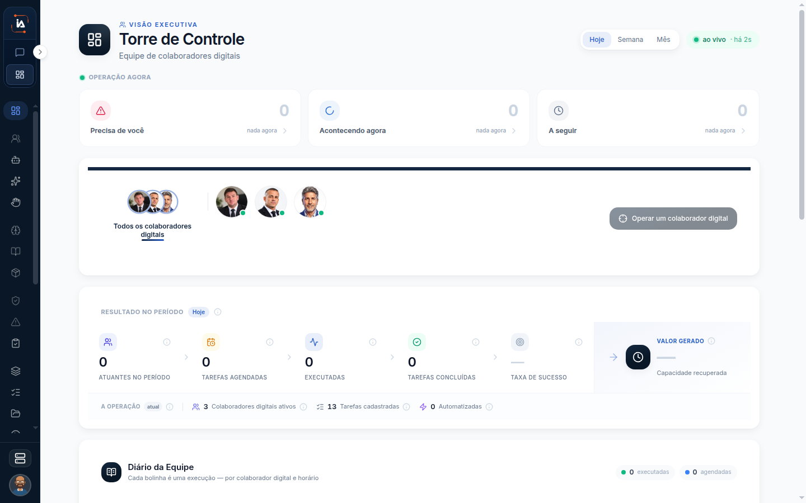

# IA Operations

IA Operations é o lado da empresa. A aba da direita abre a Torre de Controle. Dali a operação se acompanha. No mesmo menu se cadastra quem executa, a tarefa que essa pessoa digital cumpre, o que rodou e o resultado que ficou para o projeto. O chat pessoal continua na outra aba.

## Para que serve

Configura gente digital, tarefa, execução e resultado.

O caminho usual é este: criar o colaborador digital, abrir uma tarefa para ele, desenhar o fluxo, publicar e acompanhar a execução. A Torre resume o período. Atividades mostra o que já terminou. Execuções mostra o que vem, o que está rodando e o que acabou. Interações humanas é a fila do que parou para uma pessoa decidir.

## Quem vê

Quem tem projeto. Colaboradores digitais somem para Viewer e para quem não tem projeto. Conectores, Robots, Runners, Usuários e Auditoria pedem administrador.

## Onde fica

A aba da direita abre em `/central`.

## O que a tela mostra

A tela aberta é **Torre de Controle**, com a marca **VISÃO EXECUTIVA**, o período **Hoje** e **ao vivo**.

O menu reúne a Torre de Controle, a Força de trabalho, a Orquestração e a Infraestrutura.

* **Torre de Controle** responde como a operação está agora.
* **Força de trabalho** responde quem executa: colaboradores, a rotina de cada um, os Copilots do projeto e a fila humana.
* **Orquestração** responde o trabalho: atividades, tarefas, fluxo, artefatos, execuções, conectores, tabelas e robots.
* **Infraestrutura e administração** responde a conta: runners, dispositivos, auditoria, usuários, conta, projetos e chaves.

## Campos

Esta página não tem formulário.

## O que dá para fazer

Abrir cada grupo do menu.

<table data-view="cards"><thead><tr><th>Grupo</th><th data-card-target data-type="content-ref">Abrir</th></tr></thead><tbody><tr><td><strong>Torre de Controle</strong> Período Hoje, Semana ou Mês, e o filtro por colaborador digital.</td><td><a href="torre-de-controle.md">torre-de-controle</a></td></tr><tr><td><strong>Colaboradores digitais</strong> Lista do projeto. Some para Viewer e para quem não tem projeto.</td><td></td></tr><tr><td><strong>Tarefas</strong> Lista ou agenda. Criar pede o colaborador digital.</td><td><a href="tarefas.md">tarefas</a></td></tr><tr><td><strong>Execuções</strong> Lista ou linha do tempo do que rodou.</td><td><a href="execucoes.md">execucoes</a></td></tr></tbody></table>

## Limite atual

Equipes, Memória, Conhecimentos, Unidades executáveis, Políticas e alçadas, Riscos e permissões, Canais, Capacidade instalada, Performance e ROI, LLMs e Tags ainda não estão no produto. O nome fica no menu. A página não ensina um uso que a tela não tem.

## Dúvidas comuns

**Abri a Torre e não achei onde criar o agente.**
A Torre acompanha. O cadastro fica em Colaboradores digitais. Sem projeto, ou sendo Viewer, essa entrada nem aparece.

**A tarefa do meu Copilot pessoal está nesta aba?**
Não. A agenda pessoal fica em Tarefas do Copilot, no IA Assistant. Aqui a tarefa pede um colaborador digital e abre um fluxo.

**Um item do menu não abre.**
Se a página dele diz que ainda não está no produto, o título existe e a tela não. Não há campo para preencher.
