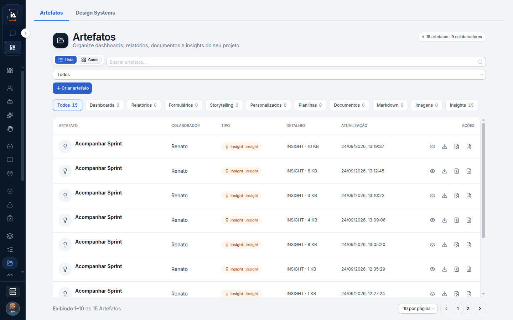

# Artefatos

Este é o acervo do projeto: dashboards, relatórios, documentos e insights. Um item pode estar na lista e ainda não publicado. Quem está fora do projeto não abre esta lista. Vê só o link que foi compartilhado. O arquivo que nasceu no seu chat pessoal não entra aqui. Ele fica em Meus artefatos.

## Para que serve

Catálogo do projeto, separado dos artefatos do chat. A lista organiza dashboards, relatórios, documentos e insights do projeto.

## Quem vê

Quem acompanha o projeto. Quem está de fora vê só o link compartilhado.

## Onde fica

`/artifacts`. O que a pessoa de fora vê fica em `/share/artifact/[token]` e `/share/insight/[token]`.

O link de artefato mostra o artefato compartilhado. O link de insight mostra o insight compartilhado. Os dois não pedem a lista interna. Quem não recebeu o link não chega por esta página.

## O que a tela mostra

O título é **Artefatos**. O canto marca **15 artefatos**.

Dá para buscar e ver quantos artefatos e colaboradores estão ligados. Os botões da lista são **Criar artefato** e **Enviar arquivo**. Busca, tipo e colaborador digital recortam o acervo. Enviar arquivo coloca um arquivo no acervo. Criar artefato abre o caminho de um artefato novo.


**Não publicado** continua na lista. O item está no acervo do projeto, mas ainda não foi publicado.


Não publicado não é rascunho escondido. Quem abre a lista vê o item e vê que ele ainda não foi publicado.

Quando o artefato nasce numa tarefa, o nó **Artefato** abre o **Studio de Artefatos**. As etapas são Definição, Dados e ações, Construção, Validação e Publicação. Na definição, a tela pede o nome, o objetivo do artefato e o design system. O padrão é o design system do projeto. Publicação é a etapa que tira o item do estado não publicado.

## Campos

Busca, tipo e colaborador digital. Na definição: nome, objetivo e design system.

## O que dá para fazer

Buscar, criar, abrir no estúdio e abrir o insight ligado ao artefato.


Esta lista não é a caixa pessoal do Copilot. O arquivo produzido no chat aparece em **Meus artefatos**. O que outra pessoa compartilhou aparece em **Compartilhado comigo**.


<table data-view="cards"><thead><tr><th>Onde o artefato aparece</th><th data-card-target data-type="content-ref">Abrir</th></tr></thead><tbody><tr><td><strong>Artefatos do chat</strong> Meus artefatos e Compartilhado comigo.</td><td><a href="/assistant/artefatos">artefatos</a></td></tr><tr><td><strong>Artefato no fluxo</strong> O nó Artefato abre o Studio de Artefatos na tarefa.</td><td><a href="/referencia/nos/artefato">artefato</a></td></tr></tbody></table>

## Limite atual

O formulário completo de **Criar artefato**, além do nome, do objetivo e do design system na definição, não está descrito aqui. As etapas do Studio são Definição, Dados e ações, Construção, Validação e Publicação.

## Dúvidas comuns

**O arquivo do chat não está neste catálogo.**
O chat guarda em Meus artefatos e em Compartilhado comigo. Este catálogo é do projeto. Um artefato só entra aqui quando nasce para o projeto, pelo botão Criar artefato, por Enviar arquivo, ou pelo nó Artefato de uma tarefa.

**Está na lista, mas ninguém de fora abre.**
**Não publicado** continua na lista e ainda não foi publicado. Quem está de fora depende do link `/share/artifact/[token]` ou `/share/insight/[token]`. Sem o link, a pessoa não vê o acervo.

**Qual design system ele usa se eu não escolher?**
O padrão é o design system do projeto. A definição também pede nome e objetivo.

**Excluí o insight na Torre. O artefato some?**
Na Torre, excluir é ação do insight: tipo, colaborador, abrir detalhe e excluir. O artefato do catálogo é outro item. O link de insight compartilhado é `/share/insight/[token]`.
