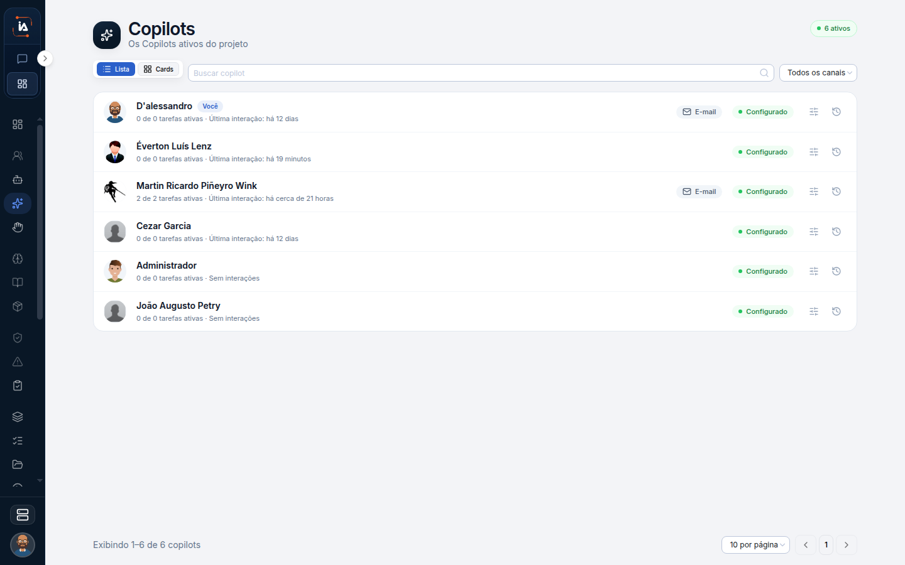

# Copilots

Copilots, neste menu, são os Copilots operacionais do projeto. A lista mostra o canal de cada um, as atividades e os logs. Não é o Meu Copilot que você configurou em Pessoal, e não é a lista de colaboradores digitais. Sem projeto selecionado, a entrada some.

## Para que serve

Lista os Copilots do projeto. É o Copilot operacional do projeto, diferente do Meu Copilot.

## Quem vê

Quem tem projeto. Some sem projeto.

## Onde fica

`/copilots` e `/copilots/[id]`, com atividades e logs.

## O que a tela mostra

O título é **Copilots**. O texto diz **Os Copilots ativos do projeto**. O canto marca **6 ativos**.

Busca e filtro de canal: todos, e-mail, WhatsApp, nenhum. A ficha mostra canais, atividades e logs.

O filtro responde se aquele Copilot do projeto tem canal, e qual. **Nenhum** mostra quem está sem e-mail e sem WhatsApp. A ficha não é o assistente de primeiro acesso. Ela mostra os canais já ligados, o que ele fez e o registro disso.

## Campos

A busca e o canal do filtro.

## O que dá para fazer

Buscar, filtrar pelo canal e abrir a ficha.

## Limite atual


Não misture com o Meu Copilot. O cadastro pessoal fica em Configurações, aba Pessoal.



[Meu Copilot](/comecar/meu-copilot)


## Dúvidas comuns

**Alterei Como eu falo e esta ficha não mudou.**
Como eu falo é do seu Meu Copilot, em Configurações, aba Pessoal. Esta ficha é de um Copilot do projeto.

**Filtrei por e-mail e a lista esvaziou.**
Nenhum Copilot do projeto está com esse canal no recorte atual. Confira também se o projeto certo está selecionado. Sem projeto, a lista nem abre.

**Isto substitui o colaborador digital?**
Não. Colaborador digital tem ficha, rotina e tarefa. Copilot do projeto é esta lista, com canais, atividades e logs.
