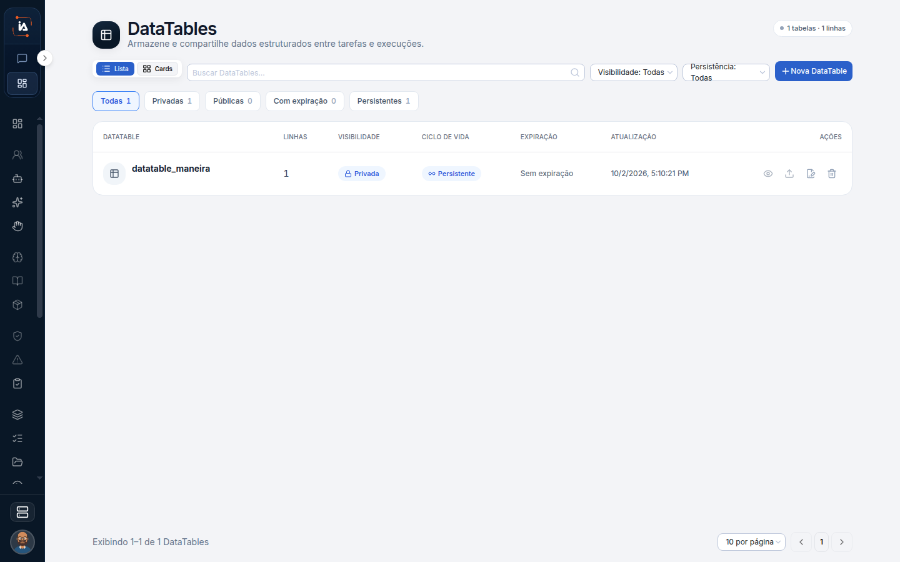

# DataTables

DataTable é uma tabela do projeto que tarefas e execuções compartilham. Ela guarda dado estruturado, com nome, visibilidade e um prazo de vida. Não é a planilha de um nó do Google Sheets, e não é o arquivo que você anexou no chat. Uma tabela privada ainda pede uma tarefa no projeto: sem tarefa, não há onde pendurá-la.

## Para que serve

Tabela ligada a uma tarefa. Guarda dados estruturados para as tarefas e as execuções do projeto usarem.


O texto da tela é: "Armazene e compartilhe dados estruturados entre tarefas e execuções."


## Quem vê

Quem administra os dados do projeto.

## Onde fica

`/datatables`. No editor de fluxo, o controle DataTables lista as tabelas usadas por aquele fluxo. As duas entradas falam da mesma tabela: a lista do projeto e o uso dentro de um fluxo.

## O que a tela mostra

O título é **DataTables**. O canto marca **1 tabelas**.

O resumo mostra quantas tabelas e quantas linhas existem. Cada linha mostra o nome, a quantidade de linhas, a visibilidade, o ciclo de vida, a expiração e a última atualização. Uma tabela persistente não expira. Uma tabela com prazo mostra a janela em horas. A coluna de expiração é o que diz até quando essa janela vale.

## Campos

Busca por **Buscar DataTables...**. Visibilidade: pública ou privada. Permanência: persistente ou janela. **Nova DataTable** pede o nome, a visibilidade e o ciclo de vida. A descrição é opcional.

Pública ou privada diz quem alcança a tabela. Persistente ou janela diz se ela fica ou se expira. A descrição ajuda quem procura na lista. Não substitui o nome.


Uma DataTable privada pede uma tarefa do projeto. Sem tarefa no projeto, a tela diz para criar uma tarefa antes.


## O que dá para fazer

Buscar, criar, editar e excluir. Depois dá para ver, editar o nome, a visibilidade, o ciclo de vida e a descrição, e renomear.


O botão de confirmação cria a tabela e avisa "DataTable criada."


## Limite atual

Sem tarefa no projeto, não há como criar uma tabela privada.


[Tarefas](tarefas.md)


## Dúvidas comuns

**A tela mandou criar uma tarefa antes.**
A tabela que você está criando é privada, e o projeto ainda não tem tarefa. Crie a tarefa, escolha o colaborador digital e volte. A tarefa é o gancho da tabela privada.

**A tabela sumiu sozinha.**
Se o ciclo de vida é janela, ela tem prazo em horas. Persistente não expira. Confira a coluna de expiração antes de concluir que alguém excluiu.

**O fluxo não vê a tabela que eu criei.**
No editor, o controle DataTables lista as tabelas usadas por aquele fluxo. Criar na lista do projeto não liga sozinho ao desenho. Abra o fluxo e use esse controle.

**Isto lê uma planilha do Google?**
Não. Planilha pública do Google Sheets é o nó Google Sheets. DataTable é a tabela do próprio projeto, compartilhada entre tarefas e execuções.
