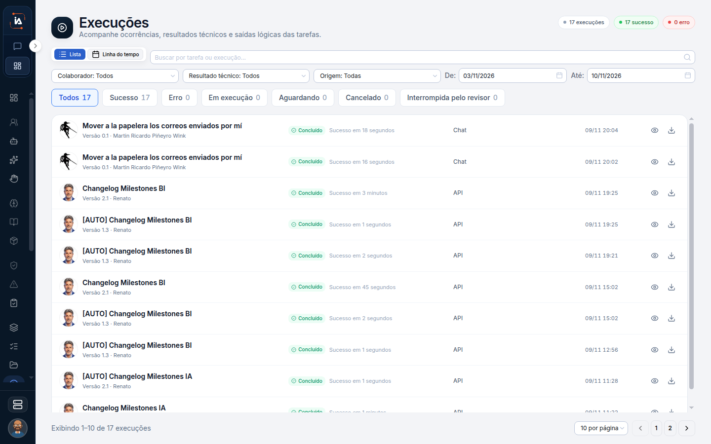

# Execuções

Execuções mostra três tempos ao mesmo tempo: o que ainda vai rodar, o que está rodando e o que já terminou. Atividades, ao lado, só lê o que já fechou em sucesso ou falha. Se a pergunta é "está em andamento?", a resposta está aqui. A tela também se apresenta como Atividade do dia.

## Para que serve

Mostra o que está por vir, o que está rodando e o que terminou.

## Quem vê

Quem acompanha o projeto.

## Onde fica

`/executions`. Lista ou linha do tempo. A lista serve para filtrar. A linha do tempo serve para ler a ordem.

## O que a tela mostra

O título é **Execuções**. O canto marca **17 execuções**, **17 sucesso** e **0 erro**.

A tela também se apresenta como **Atividade do dia**: as próximas execuções, as execuções recentes e o que está em andamento. O resumo pode dizer quantas tarefas estão agendadas para hoje, em quanto tempo vem a próxima, qual foi a última e se alguma está em execução.


Quando não há nada marcado para o dia, a mensagem é "Nenhuma execução agendada para hoje".


Essa mensagem não significa que o projeto nunca rodou. Significa que não há execução marcada para hoje.

| Status | O que significa |
| --- | --- |
| Sucesso | A execução terminou |
| Falhou | A execução terminou com falha |
| Executando | A execução está em andamento |
| Aguardando | A execução espera uma condição ou uma resposta |
| Cancelado | A execução foi cancelada |
| Interrompida pelo revisor | Um revisor interrompeu a execução |
| Ignorado | O passo não rodou |

Aguardando é o estado em que uma revisão humana pode estar no caminho. A fila para responder fica em Interações humanas. Ignorado é um passo que não rodou, diferente de falhou.

## Campos

Busca, projeto, colaborador, resultado (sucesso, falha, em execução, aguardando, cancelada, interrompida), origem (agenda, manual e as outras que a tela listar) e intervalo de datas.

A origem diz por que a execução nasceu. Agenda é o horário da tarefa. Manual é um disparo feito por alguém. O intervalo de datas limita o período, independente do recorte Hoje da Torre.

## O que dá para fazer

Baixar, tentar de novo e encerrar. Quem tem permissão pode cancelar uma execução em andamento. Durante o pedido, o botão mostra **Cancelando...**.


Ao terminar, a mensagem é **Execução cancelada**.


Tentar de novo dispara outra vez o que você está vendo. Baixar guarda uma cópia. Encerrar para a execução em andamento. Uma execução que já terminou não volta a aguardar pessoa.

## Limite atual


Se o cancelamento já estiver em andamento, se a execução não for encontrada ou se você não tiver permissão, a tela explica o motivo e nada além disso é cancelado.


Uma execução cancelada ou já encerrada não cria revisão humana.


[Interações humanas](interacoes-humanas.md)


## Dúvidas comuns

**Está Aguardando. O que eu faço?**
A execução espera uma condição ou uma resposta. Se a espera é uma pessoa, abra Interações humanas. Responder faz o fluxo seguir pela saída Respondido. Deixar o prazo acabar faz seguir pela saída Timeout.

**Cancelei e nasceu um pedido de aprovação.**
Não nasce. Uma execução cancelada ou já encerrada não cria revisão humana. Se o botão ficou em **Cancelando...**, o pedido já está em curso. Um segundo cancelamento não avança além do que a tela explicar.

**A lista de tarefas diz que a última execução ficou indisponível.**
A lista de tarefas continua aberta. O histórico e o estado ficam nesta tela, com busca, colaborador, resultado, origem e intervalo de datas.

**Não há nada hoje, mas a tarefa existe.**
A tarefa pode estar inativa, sob demanda, ou fora do dia. A mensagem "Nenhuma execução agendada para hoje" fala do dia, não do cadastro da tarefa.
