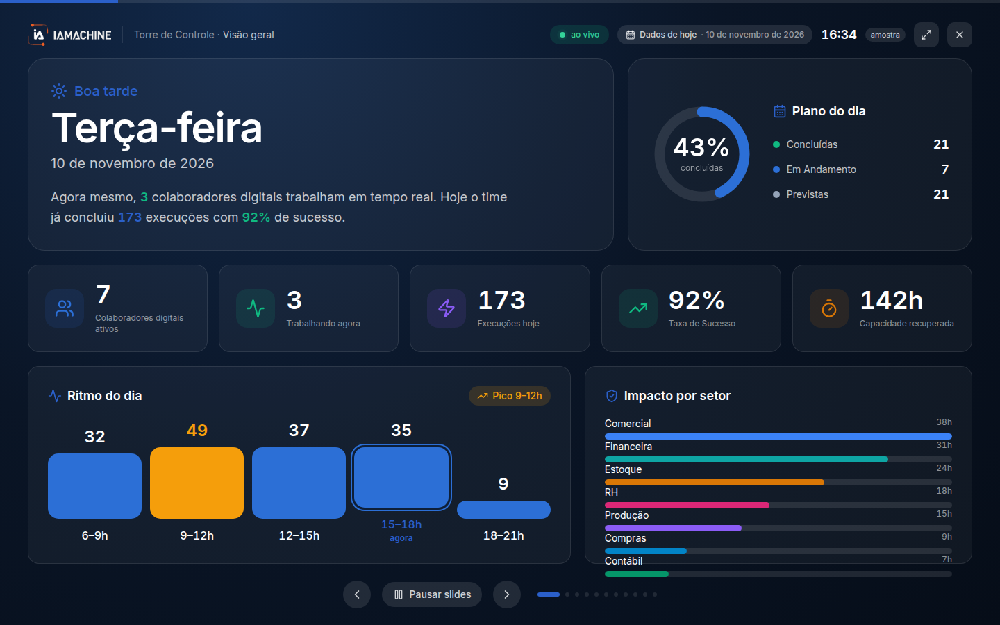

# Modo TV

O Modo TV é a Torre em tela cheia, para um painel que fica ligado sem alguém operando o menu. Ele repete cenas da operação. Não cria tarefa, não responde fila e não substitui a Torre quando você precisa filtrar ou abrir um insight.

## Para que serve

Mostra a Torre de Controle em tela cheia, para um painel.

## Quem vê

Quem abre a Torre de Controle.

## Onde fica

`/central/tv`. Não está no menu lateral. A página fica ligada à Torre.

## O que a tela mostra

O alto diz **Torre de Controle · Visão geral**, **ao vivo**, **Dados de hoje** e **amostra**. Embaixo está **Pausar slides**.

Cenas de visão geral, equipe, ao vivo e atenção. Tema claro ou escuro. Intervalo entre cenas.

A visão geral é o retrato do período. Equipe mostra os colaboradores digitais. Ao vivo é a cena do que está acontecendo. Atenção é a cena do que pede olhar. O tema só muda a apresentação, claro ou escuro. O intervalo é o tempo entre uma cena e a próxima.

## Campos

O tema e o intervalo entre cenas.

## O que dá para fazer

Deixar o painel rodando nas cenas. Para buscar uma execução, filtrar a fila humana ou lançar um chat, volte à Torre.

## Limite atual

Não há entrada desta tela no menu lateral.


[Torre de Controle](torre-de-controle.md)


## Dúvidas comuns

**Não acho Modo TV no menu.**
Ele não está no menu lateral. O caminho é a Torre, em `/central/tv`.

**A TV não mostra o chat para eu digitar.**
Esta tela só alterna as cenas. A barra de texto e voz fica na Torre e abre o chat do colaborador.
