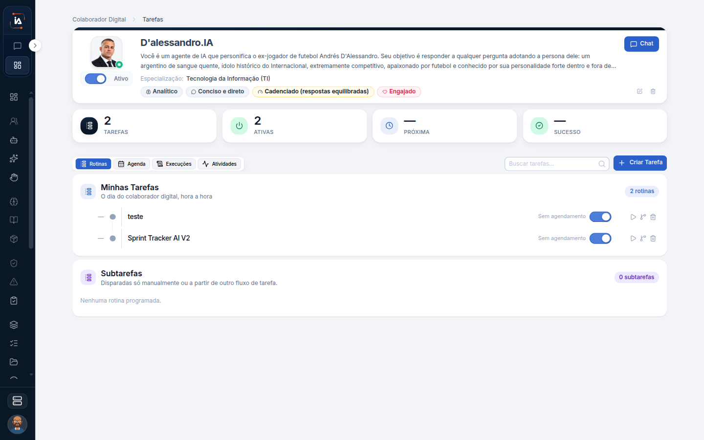

# Rotina do colaborador

A rotina é a página do colaborador já criado. A ficha diz quem ele é. Esta página mostra o que está na linha do tempo dele: rotinas, tarefas avulsas e o calendário. Chat, atividades, conhecimento e logs são atalhos desta mesma página. Não são manuais separados.

## Para que serve

Mostra a rotina de um colaborador digital já aberto.

## Quem vê

Quem pode abrir o colaborador no projeto. Viewer e quem está sem projeto nem chegam na lista.

## Onde fica

`/agent/[id]`.

## O que a tela mostra

Cabeçalho, rotinas na linha do tempo, tarefas avulsas e calendário.

O cabeçalho identifica o colaborador que você abriu. As rotinas na linha do tempo são o que se repete. As tarefas avulsas são o trabalho pontual. O calendário junta isso no tempo. Se a dúvida é o desenho do passo a passo, ele está no editor de fluxo da tarefa, não nesta linha do tempo.

## Campos

O que esta página descreve são esses blocos. O miolo de cada bloco, campo a campo, não está detalhado aqui.

Na tela aparecem **Chat**, **Ativo**, **Rotinas**, **Agenda**, **Execuções**, **Atividades**, **Minhas Tarefas** e **Subtarefas**.

## O que dá para fazer

Abrir os atalhos desta mesma ficha. Chat, atividades, conhecimento e logs ficam em `/agent/[id]/chat`, `/activities`, `/knowledge` e `/logs`. São atalhos desta página, não capítulos separados.

* O chat deste endereço é a conversa daquele colaborador, não o Meu Copilot.
* Atividades e logs mostram o rastro dele.
* Conhecimento é o atalho da ficha, não uma biblioteca nova do menu.

## Limite atual

Esses quatro atalhos não viram páginas próprias.


[Ficha do colaborador](ficha.md)


## Dúvidas comuns

**Quero mudar o tom ou o gestor.**
Isso é ficha, em `/agent/[id]/edit`, não a rotina.

**O chat deste colaborador é privado como o meu?**
Não. O Meu Copilot é que marca "Só você conversa com ele". Este atalho abre a conversa do colaborador da operação.

**Não acho uma página chamada Logs no menu.**
Logs, chat, atividades e conhecimento são atalhos desta rotina. O menu não ganha um capítulo para cada um.
