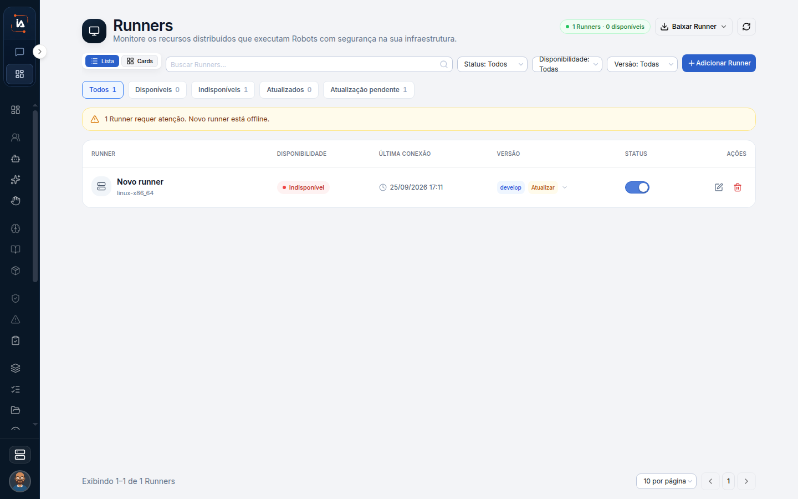

# Runners

Runner é a instalação ligada a este projeto que executa o robot. O menu avisa quando algum está offline, porque um passo Robot sem máquina online não tem onde rodar. O vínculo nasce no aplicativo desktop, depois do login. Esta tela lista o que já foi vinculado, o estado e a versão.

## Para que serve

Lista a máquina que executa o robot neste projeto. O texto da tela é: "Instalações do Runner vinculadas a este projeto."

## Quem vê

Só administrador.

## Onde fica

`/settings/runners`.

## O que a tela mostra

O título é **Runners**. O canto marca **1 Runners**.

Cada Runner mostra dispositivo, versão, status e último contato. Se houver versão nova, a lista marca **Atualização disponível**. O status é Online ou Offline. Último contato diz quando a instalação falou com o projeto. Offline com último contato antigo é uma máquina que já esteve ligada e parou. A lista vazia é outra situação: ainda não há vínculo.


O menu avisa **Há Runner offline** quando algum está fora. Sem nenhum, a mensagem é: "Nenhum Runner vinculado ainda. Vincule pelo aplicativo desktop após o login."


## Campos

Cadastro, status e atualização. **Editar Runner** altera o nome. O nome é obrigatório e tem no máximo 120 caracteres. A confirmação é **Runner atualizado**. O nome é o rótulo na lista. Não liga nem desliga a máquina.

## O que dá para fazer

Cadastrar, atualizar e remover o vínculo. Atualizar trata a marca **Atualização disponível**. Remover tira o vínculo deste projeto. A instalação deixa de ser a máquina que este projeto usa.

## Limite atual


Remover tira o vínculo do projeto. A confirmação é **Runner removido**.



Sem um Runner online nesse projeto, o passo Robot não tem onde rodar.


Quem não é administrador não vê Runners.


[Robots](robots.md)


## Dúvidas comuns

**O menu mostra Há Runner offline. A tarefa inteira parou?**
O aviso fala do Runner. O passo que depende dele é o Robot. O restante do fluxo não é descrito por esse aviso. Sem um Runner online, o passo Robot não tem onde rodar.

**Não aparece nenhum.**
Ainda não houve vínculo. A tela pede: "Nenhum Runner vinculado ainda. Vincule pelo aplicativo desktop após o login."

**Posso só renomear?**
Sim. Editar Runner altera o nome, obrigatório, com no máximo 120 caracteres, e confirma **Runner atualizado**. Remover é outra ação e confirma **Runner removido**.
