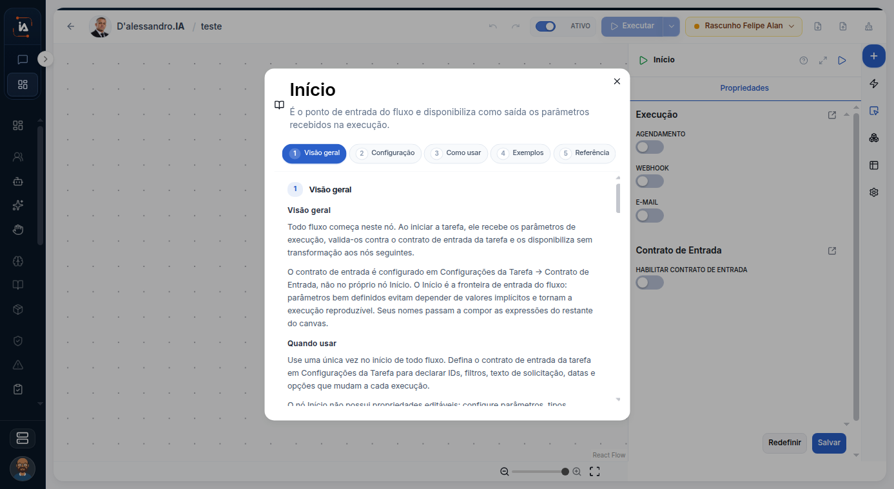

# Início

Todo fluxo começa no Início. Os nós seguintes só entram na tarefa se houver um caminho ligando-os a este ponto. Um bloco solto no canvas não faz parte do que a execução percorre.

## Para que serve

Ponto de partida do fluxo.

## Quem vê

Quem desenha a tarefa no editor de fluxo.

## Onde fica

Na paleta do editor, em `/task/[id]/flow`. O botão do nó é **Abrir manual do nó**.

## O que a tela mostra

O bloco no canvas e a ligação com o nó anterior e o seguinte. O manual que abre no editor, quando existe, separa visão geral, configuração, como usar, exemplos e referência. Se ainda não houver texto, a tela diz: "Ainda não há manual para este nó." Esta página não completa essas partes no lugar da tela.

## Campos

Os campos de configuração ficam no manual do nó, dentro do editor. Não estão repetidos aqui.

O manual aberto separa **Visão geral**, **Configuração**, **Como usar**, **Exemplos** e **Referência**. Em **Visão geral**, o título **Quando usar** aponta o contrato para **Configurações da Tarefa** e **Contrato de Entrada**.

## O que dá para fazer

Colocar o nó no caminho que sai do Início, ligar o passo anterior e o seguinte, e abrir o manual quando ele tiver texto.

## Limite atual

Sem o manual publicado na tela, não há passo a passo de configuração nesta página.

## Dúvidas comuns

**O fluxo não fez o passo que eu desenhei.**
Confira se existe uma ligação desde o Início até esse nó. Publicar é o que faz a versão valer. O desenho sem publicar não troca a versão que a operação usa.
